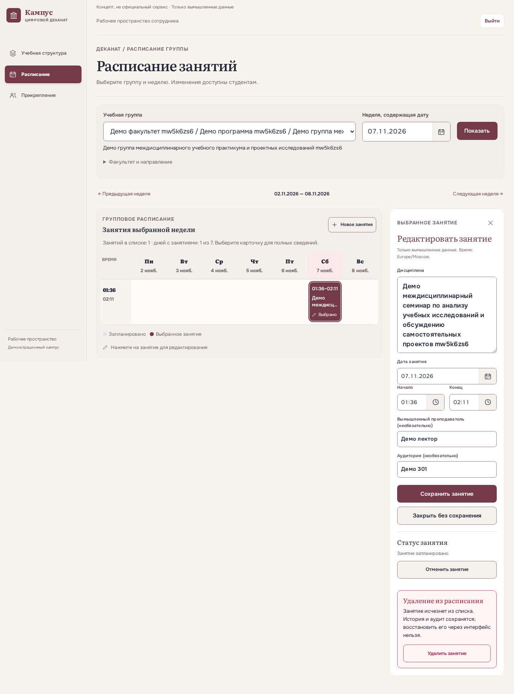

# Кампус

**«Кампус»** — рабочее название университетской веб-платформы в рамках конкурсного проекта **«Цифровой деканат будущего»**. Это демонстрационный MVP, **не официальный сервис университета** и не публично развёрнутая информационная система. Финальные название, логотип и домен не утверждены.

Платформа объединяет два интерфейса: **студент** просматривает данные своей учебной группы, **сотрудник деканата** управляет учебной структурой, расписанием и прикреплением студентов. Для демонстрации используется один вымышленный вуз и синтетические записи; возможность нескольких вузов учитывается архитектурно, но полноценная мультиарендность не входит в MVP. Встроенного ИИ-помощника в MVP нет.

> **Статус на 7 ноября 2026:** фундамент, прикрепление студентов, структура и расписание реализованы в `main`. Редизайн **Academic Editorial 2.0** включён в `main` через [PR #35](https://github.com/bam-low/mgimo/pull/35); [Issue #34](https://github.com/bam-low/mgimo/issues/34) закрыта. **Успеваемость, обычные заявки/справки и уведомления ещё не реализованы.** Production — **NO-GO**; публичный адрес и развёртывание не заявляются.

## Возможности MVP: реализовано и запланировано

| Область | Реализовано в `main` | Следующий этап |
| --- | --- | --- |
| Доступ и профиль | Демо-регистрация студента, вход, выбор группы, ожидание подтверждения, отказ и повторная подача; серверные проверки прав | Дополнительные сценарии только по отдельным Issues |
| Деканат | Подтверждение, перевод и отзыв прикрепления с аудитом; управление факультетами, направлениями и группами | Обработка обычных заявок и справок |
| Расписание | Создание, редактирование, отмена и восстановление датированных занятий; расписание студента по действующей группе | Дополнительные возможности — после MVP |
| Главная студента | Сегодняшние занятия, текущая пара, прогресс по времени вуза, состояния до занятий/перемены/после занятий/пустого дня | — |
| Успеваемость | Не реализована | Ввод и управление оценками сотрудником, просмотр собственных оценок студентом |
| Заявки и справки | Не реализованы (прикрепление — отдельный уже работающий процесс) | Подача, статусы, обработка, вымышленные документы |
| Уведомления | Не реализованы | События и статусы, доступные соответствующей роли |

Регистрация в **текущем приложении** создаёт техническую демонстрационную личность и учётные данные на сервере; свободный ввод ФИО/email при регистрации сейчас не реализован. Это описание существующего поведения, а не запрет на отдельные будущие продуктовые решения. Тестовые и подготовленные демонстрационные записи должны оставаться вымышленными. Не использовать реальные персональные данные в seed, скриншотах и тестах.

**Граница доступа:** студент получает учебные данные только после подтверждения прикрепления и только по своей активной группе. При переводе старая группа перестаёт быть доступной для новых запросов; изменение и отзыв фиксируются в аудите. Роль сотрудника не выдаётся через публичную регистрацию. Подробнее: [архитектура](docs/ARCHITECTURE.md), [контракты расписания](docs/SCHEDULE.md), [передача функциональных модулей](docs/FEATURE_HANDOFF.md).

## Интерфейс

Утверждённое направление — **Academic Editorial 2.0**: локальные шрифты **Literata** и **Onest**, основная палитра `#753A4A` / `#25283B` / `#E7E0F2` / `#F7F4EE`. Адаптивная компоновка рассчитана от **360 CSS px**; для сотрудника предусмотрены компактная сетка занятий и подробный inspector. Даты и время в интерфейсе представлены в формате `ДД.ММ.ГГГГ` и `ЧЧ:ММ`, при этом серверные временные контракты и часовой пояс университета сохраняются.

| Студент — 390 px | Деканат — 1280 px |
| --- | --- |
|  |  |

Это **скриншоты локально запущенного приложения с вымышленными данными**, не изображения опубликованного сервиса. [Галерея и сравнения 360/390/1280](docs/screenshots/issue-34/review-2026-11-07/README.md) · [визуальные исходники и лицензии](docs/design/ASSET_INVENTORY_V3.md) · [дизайн-решения](docs/design/APPROVED_V3_IMPLEMENTATION.md) · [токены](docs/design/TOKENS.md).

## Технологии и устройство

- **Приложение:** Next.js 16.4.5 (App Router), React 19, TypeScript 5.9, Tailwind CSS 4.
- **Данные:** PostgreSQL 17, Prisma 7, `@prisma/adapter-pg`.
- **Доступ:** Better Auth 1.7.17, серверная авторизация по роли, университету и действующему прикреплению, аудит изменений.
- **Проверки:** ESLint, TypeScript, Vitest, Playwright, PostgreSQL integration и GitHub Actions.
- **Развёртывание:** подготовлены и тестируются отдельные пути Next.js standalone, Vercel Functions/Neon и VPS. Наличие проверяемого артефакта **не означает** разрешение на публикацию.

Это модульный монолит, не набор независимых микросервисов. Точные версии и команды определяются `package.json` и `package-lock.json`. Правила безопасности, границы доступа и открытые вопросы: [PRD](docs/PRD.md), [Architecture](docs/ARCHITECTURE.md), [Decisions](docs/DECISIONS.md).

## Локальный запуск

**Требования:** Node.js 24 (см. `.nvmrc`), npm 11, PostgreSQL 17. Для воспроизводимости используйте lockfile и локальную **пустую** БД, не production. Пример ниже предназначен для macOS/Linux с Docker и Bash. Не вставляйте настоящие пароли в Issues, логи или скриншоты.

1. Установите зависимости:

   ```sh
   npm ci --ignore-scripts
   ```

2. Создайте локальную БД PostgreSQL 17. Пароль вводится без отображения и передаётся Docker как переменная окружения; вместо пароля нельзя использовать буквальный текст `POSTGRES_PASSWORD`:

   ```sh
   read -rs -p "Локальный пароль PostgreSQL: " POSTGRES_PASSWORD
   echo
   export POSTGRES_PASSWORD
   docker run --name campus-local-pg -d \
     -e POSTGRES_USER=campus \
     -e POSTGRES_DB=campus_dev \
     -e POSTGRES_PASSWORD \
     -p 127.0.0.1:5432:5432 \
     postgres:17-bookworm@sha256:839fbb5a4942a7758dd93e18b42ea5649807491a0545b5eeeb8f0b8bb11857a5
   ```

3. Скопируйте `.env.example` в `.env.local`. Заполните `DATABASE_URL` для созданной локальной БД, `BETTER_AUTH_URL=http://localhost:3000` и случайный `BETTER_AUTH_SECRET` (не менее 32 случайных байт, например с помощью `node -e "console.log(require('crypto').randomBytes(32).toString('hex'))"`). Если пароль БД содержит специальные символы, корректно URL-кодируйте их в строке подключения. `.env.local` не коммитьте.

4. Создайте Prisma client и примените миграции **только к локальной БД**:

   ```sh
   node --env-file=.env.local node_modules/prisma/build/index.js generate
   node --env-file=.env.local node_modules/prisma/build/index.js migrate deploy
   ```

5. Для первоначального вымышленного наполнения установите в `.env.local` `ALLOW_DEMO_SEED=yes` и **три различных сильных пароля** `DEMO_STAFF_PASSWORD`, `DEMO_STUDENT1_PASSWORD`, `DEMO_STUDENT2_PASSWORD` (12–128 символов). Затем:

   ```sh
   node --env-file=.env.local prisma/seed.mjs
   npm run dev
   ```

Откройте [http://localhost:3000](http://localhost:3000). Seed создаёт технические демонстрационные учётные записи `staff@example.test`, `student1@example.test` и `student2@example.test`; их пароли берутся только из локального окружения. Повторный seed не предназначен для сброса уже изменённых прав или паролей. Доступ сотрудника выдаётся только доверенным seed-процессом.

**Важно:** Next.js загружает `.env.local` для приложения, но отдельные Prisma/seed-скрипты требуют явно переданных переменных окружения. Не направляйте миграции или seed на реальную пользовательскую БД. Дополнительные сценарии — в [документации расписания](docs/SCHEDULE.md) и [инструкциях развёртывания](docs/VPS_DEPLOY_RUNBOOK.md).

## Проверки

Базовые проверки в корне репозитория:

```sh
npm run lint
npm run typecheck
npm test -- --run
python3 scripts/check_docs.py
git diff --check
```

**Integration и E2E выполняйте только на отдельной БД с именем, оканчивающимся на `_test`.** Она должна быть создана и настроена отдельно; перед запуском задайте для неё `DATABASE_URL` и тестовые значения остальных обязательных переменных. Эти проверки создают и изменяют записи и не должны использовать обычную demo/production БД.

```sh
npm run db:generate
npm run db:migrate
npm run db:seed
npm run test:integration
npm run build
npm run check:runtime
npx --no-install playwright install chromium
npm run test:e2e
```

Команды выше предполагают **уже экспортированные переменные тестового окружения**. Для Functions и VPS есть отдельные сборки, E2E и security/backup-проверки; детали — в [runbook VPS](docs/VPS_DEPLOY_RUNBOOK.md), [чеклисте запуска](docs/VPS_LAUNCH_CHECKLIST.md) и workflow в `.github/workflows/`. Актуальные результаты CI относятся к конкретным коммитам и доступны в соответствующих Pull Requests, в частности [PR #35](https://github.com/bam-low/mgimo/pull/35).

## Документация и процесс разработки

| Документ | Назначение |
| --- | --- |
| [AGENTS.md](AGENTS.md) | Правила работы ИИ-инструментов и границы изменений |
| [PRD](docs/PRD.md) | Продуктовые сценарии, роли, критерии приёмки |
| [Architecture](docs/ARCHITECTURE.md) | Модель данных, доступ, безопасность и открытые вопросы |
| [Decisions](docs/DECISIONS.md) | Принятые и предложенные решения |
| [Schedule](docs/SCHEDULE.md) | Контракты учебной структуры и расписания |
| [Design](docs/DESIGN.md) | Визуальная система и статус утверждений |
| [AI Log](docs/AI_LOG.md) | Документирование применения ИИ в разработке |
| [План проекта — Issue #25](https://github.com/bam-low/mgimo/issues/25) | Этапы до внутреннего срока 21 ноября |
| [Issue #36](https://github.com/bam-low/mgimo/issues/36) | Задача актуализации README |

**Процесс:** согласованная GitHub Issue → реализация в отдельной ветке → проверки и CI → Draft Pull Request → **ручное утверждение и merge**. Прямые изменения `main`, автоматический merge и deploy без отдельного решения не допускаются. Новые функциональные вертикали требуют отдельных утверждённых Issues; документационная задача не разрешает изменение схемы БД, API, seed или бизнес-логики.

Для следующего разработчика или ИИ-инструмента: сначала изучите `AGENTS.md`, `docs/PRD.md`, `docs/ARCHITECTURE.md`, `docs/DECISIONS.md` и соответствующую функциональную спецификацию. Сверяйте фактический `main` и открытые PR: **предложение или макет не равны реализованной функции**.

## Дорожная карта и ограничения запуска

Следующие вертикали по [утверждённому плану](https://github.com/bam-low/mgimo/issues/25): **успеваемость → заявки и справки → уведомления → сквозной MVP/UX-аудит → конкурсные материалы**. Целевой ориентир готовности к развёртыванию — **18 ноября 2026**, внутренний срок проекта — **21 ноября 2026**. Это внутренние ориентиры, не заявление об официальном дедлайне конкурса.

**Production NO-GO:** локальные сборки, GitHub CI и тесты VPS/backup-restore не заменяют проверку реального хоста, TLS, доступности из РФ, сетевых ограничений, секретов, защиты регистрации и security review. В [security review VPS](docs/VPS_SECURITY_REVIEW.md) отмечены исторические vendor-unfixed HIGH, требующие отдельного решения перед публикацией; последний отчёт `npm audit --omit=dev` для UI PR не снимает остальные риски. Полный WCAG/screenreader и реальные мобильные клавиатура/safe-area также остаются задачами итоговой приёмки. Публичный запуск, покупка ресурсов и передача настоящих секретов не выполняются этим репозиторием автоматически.
