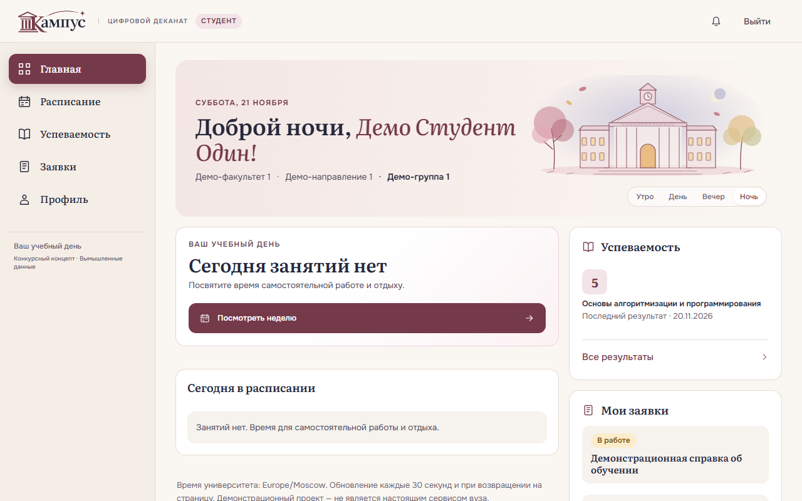

# Кампус

**«Кампус»** — демонстрационный цифровой деканат для конкурса «Цифровой деканат будущего». Студент в одном кабинете видит, куда идти на пару, свои оценки и долги, объявления деканата и статус заявок. Сотрудник деканата ведёт учебную структуру, составляет расписание — вручную или загрузкой таблицы, — выставляет результаты, публикует объявления и отвечает на обращения. Вуз, люди и документы вымышленные; проект не является настоящим сервисом вуза.

## Как посмотреть

Стенд: **https://213-109-106-89.fatmetal.net** — работает с телефона и компьютера.

| Роль | Логин | Пароль |
| --- | --- | --- |
| Студент 1 | `student1@example.test` | `Kampus-Student-1` |
| Студент 2 | `student2@example.test` | `Kampus-Student-2` |
| Сотрудник деканата | `staff@example.test` | выдаёт владелец стенда |

Самостоятельная регистрация тоже работает, но новый аккаунт получает учебный доступ только после одобрения сотрудником, поэтому для знакомства удобнее готовые аккаунты. Не вводите настоящие ФИО, почту или пароли.

**Короткий маршрут.** Студент: главная (текущая пара, объявления, приветствие по времени суток) → «Расписание» → «Успеваемость» и блок «Можно исправить» → «Заявки» → «Портфолио» (на телефоне — из «Профиля») → «Профиль». Сотрудник: «Учебная структура» → «Расписание» (семестр → «Вручную» или «Из таблицы») → «Успеваемость» → «Студенты» → «Заявки» → «Объявления» → «Портфолио».

## Что умеет

| Область | Студент | Сотрудник деканата |
| --- | --- | --- |
| Аккаунт и группа | Получает демонстрационные реквизиты, просит прикрепление к группе и видит статус | Одобряет или отклоняет прикрепление, переводит студента, отзывает доступ |
| Учебная структура | Видит свой факультет, направление и группу | Ведёт факультеты, направления, группы и курсы; архив и удаление пустых записей |
| Расписание | День и неделя своей группы, текущая пара и её ход на главной; **«Перенесено»** с исходным временем и аудиторией; экзамены сессии в общем списке | Семестр с числителем и знаменателем, конструктор занятий, общие лекции, **импорт из таблицы CSV** с предпросмотром конфликтов, отмена и **перенос** отдельной пары с уведомлением студентов, **удаление всего расписания семестра** |
| Успеваемость | Оценки и зачёты по дисциплинам, средний балл; **«Можно исправить»** — «2» и «незачёт», которые снимаются поздней положительной оценкой или отметкой самого студента; **«Сессия»** — обратный отсчёт, результат и «Сдано N из M» | Выставление, исправление и аннулирование результатов с историей изменений; **сессия** — экзамены, зачёты и консультации с проверкой пересечений, перенос и отмена |
| Объявления | Свежие объявления на главной с кнопкой «Прочитано» и раздел со всеми объявлениями | **Объявления** для вуза, факультета, направления или группы со сроком 1–5 дней или бессрочно |
| Дедлайны | **«Сроки»** на главной с обратным отсчётом, отметка «Сделано», напоминание за 48 часов | Дедлайны для вуза, факультета, направления или группы; адресаты сразу получают уведомление |
| Портфолио | **Работы с одним PDF**: «Сохранить без модерации» (видно только себе, вузом не учитывается) или «Отправить на модерацию»; статус «Подтверждено деканатом», причина отклонения, повторная отправка, уведомление о решении | Очередь работ на модерации, «Подтвердить» / «Отклонить» с комментарием, достижения выбранного студента (без скрытых работ) |
| Заявки и справки | Обращения и заказ вымышленной справки, статус и скачивание документа | Обработка, ответ, загрузка версии документа, история действий |
| Уведомления | Личные уведомления о решениях, заявках, отменах и переносах, сессии и дедлайнах | Отмена и перенос пары или экзамена автоматически уведомляют студентов затронутых групп |

Подробнее: [расписание](docs/SCHEDULE.md) · [семестры](docs/SEMESTERS.md) · [рабочее пространство сотрудника](docs/STAFF_ACADEMIC_WORKSPACE.md) · [успеваемость](docs/GRADES.md) · [заявки](docs/APPLICATIONS.md) · [уведомления](docs/NOTIFICATIONS.md).

## Интерфейс

Тёплая академическая палитра (бордовый `#753A4A`, чернильный `#25283B`, бумажный фон), локальные шрифты Literata и Onest, логотип и иконка нарисованы владельцем в Figma ([исходники](docs/design/figma-logo/)). Экраны проверены на 360, 390, 768 и 1280 px.

| Первый экран · 1280 px | Главная студента · 390 px |
| --- | --- |
|  |  |
| **Главная студента · 1280 px** | **Сотрудник · расписание · 1280 px** |
|  |  |

[Дизайн и токены](docs/DESIGN.md)

## Как устроено

Модульный монолит на **Next.js** (App Router, React, TypeScript), **PostgreSQL** через **Prisma**, сессии **Better Auth**. Все проверки доступа — на сервере: роль, вуз, действующее прикрепление и принадлежность конкретной записи. Изменения учебных данных пишутся в неизменяемый журнал аудита. На VPS приложение, инструменты миграций и PostgreSQL работают в отдельных контейнерах за Nginx с HTTPS; база доступна только внутри сервера, у приложения отдельная роль без права удалять историю. [Архитектура и матрица доступа](docs/ARCHITECTURE.md) · [Безопасность VPS](docs/VPS_SECURITY_REVIEW.md)

## Локальный запуск

Нужны Git, Docker, Node.js 24 ([`.nvmrc`](.nvmrc)) и npm 11. Подробно — в [инструкции локального демо](docs/LOCAL_DEMO.md): она поднимает отдельный PostgreSQL 17 на loopback и создаёт вымышленные данные.

```bash
node scripts/local-demo.mjs init
npm ci --ignore-scripts
node --env-file=.env.local node_modules/prisma/build/index.js generate
node --env-file=.env.local node_modules/prisma/build/index.js migrate deploy
node --env-file=.env.local prisma/seed.mjs
node node_modules/next/dist/bin/next dev --hostname 127.0.0.1
```

Откройте [localhost:3000](http://localhost:3000). Логины те же, случайные пароли — в вашем `.env.local`.

## Проверки

| Команда | Что проверяет |
| --- | --- |
| `npm run lint`, `npm run typecheck` | Правила кода и типы |
| `npm test -- --run` | Unit-тесты |
| `npm run test:integration` | Права и сценарии на отдельной тестовой PostgreSQL (имя БД с суффиксом `_test`) |
| `npm run test:e2e` | Браузерные сценарии на собранном приложении |
| `python3 scripts/check_docs.py` | Документация: обязательные файлы и ссылки |

Выпуск для VPS собирается и проверяется целиком (полный E2E, репетиция обновления со старой базы и отката, сканирование образов), подписывается владельцем и устанавливается по [инструкции обновления](docs/VPS_UPDATE_RUNBOOK.md).

## Передача проекта

Как продолжить работу другому человеку вместе с нейросетью — что прочитать, как запустить, какие правила соблюдать и что передать лично, а не через репозиторий: **[docs/HANDOFF.md](docs/HANDOFF.md)**.

## Документация

| Документ | Для чего |
| --- | --- |
| [Передача проекта](docs/HANDOFF.md) | Старт для нового разработчика и ИИ-ассистента |
| [История создания](docs/PROJECT_CREATION_HISTORY.md) | Хронология, решения, роль человека и ИИ |
| [Журнал ИИ](docs/AI_LOG.md) | Записи итераций с проверками |
| [Требования](docs/PRD.md) и [решения](docs/DECISIONS.md) | Объём MVP и его изменения |
| [Архитектура](docs/ARCHITECTURE.md) и [дизайн](docs/DESIGN.md) | Устройство системы и визуальные правила |
| [Локальное демо](docs/LOCAL_DEMO.md) | Воспроизведение сценариев на своём компьютере |
| [Обновление VPS](docs/VPS_UPDATE_RUNBOOK.md) и [развёртывание](docs/VPS_DEPLOY_RUNBOOK.md) | Подпись, резервная копия, миграции, откат |
| [Правила работы с ИИ](AGENTS.md) | Ветки, PR, тесты, запреты |
