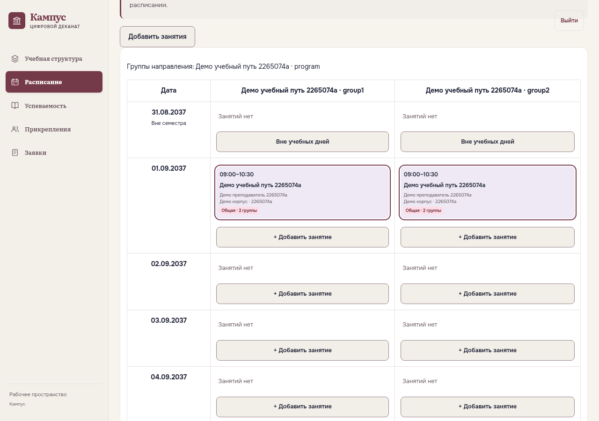

# Кампус

**«Кампус»** — демонстрационная веб-платформа для конкурса «Цифровой деканат будущего». Студент узнаёт, куда идти на следующую пару, видит свои оценки и обращается за справкой. Сотрудник деканата ведёт учебную структуру, расписание и журнал, а также отвечает на обращения. Для демонстрации используются вымышленный вуз, учётные записи и документы.

**Статус на 19 ноября 2026 года.** Подписанный выпуск [`ce36c6c`](https://github.com/bam-low/mgimo/commit/ce36c6ca748f10f1ce79211af927b7365fedb4ba) работает на закрытом VPS. В него вошли единое расписание сотрудника, курсы групп, уведомления об отмене и обновлённый журнал оценок. Следующий этап — финальная доводка интерфейсов студента и сотрудника и логотипа. Публичный запуск и доступ жюри из России требуют отдельной приёмки. [История создания проекта](docs/PROJECT_CREATION_HISTORY.md) · [Трекер](https://github.com/bam-low/mgimo/issues/25)

## Что умеет «Кампус»

| Область | Студент | Сотрудник деканата |
| --- | --- | --- |
| Учётная запись и группа | Получает демонстрационные реквизиты, отправляет запрос на прикрепление и видит статус | Подтверждает или отклоняет запрос, переводит студента и отзывает прикрепление |
| Учебная структура | Видит свою активную группу и направление после подтверждения | Ведёт факультеты, направления и группы. Курс задаётся группе. Пустые записи можно удалить с подтверждением, записи с историей доступны для архивирования |
| Расписание | Смотрит день и неделю своей группы. На главной видит ближайшую или текущую пару и её ход | На одном экране настраивает семестр, выбирает группу, закрепляет преподавателя и аудиторию, просматривает даты и конфликты перед публикацией |
| Успеваемость | Видит свои оценки и зачёты, карточки дисциплин и средний балл | Выбирает группу и студента, выставляет и исправляет оценки. Средний за выбранный период рассчитывается по тем же правилам для обеих ролей |
| Заявки и справки | Подаёт обращение, следит за статусом и скачивает доступную версию вымышленной справки | Ведёт обработку, отвечает и прикладывает файл. Сохраняются история действий и версии документа |
| Уведомления | Получает внутренние уведомления по своим событиям, включая отмену отдельной пары | Отменяет конкретное занятие. Студенты затронутых групп получают уведомления, а остальные даты серии остаются в расписании |

Семестр можно начать в любой день недели. Конструктор поддерживает разовые и еженедельные занятия, числитель и знаменатель, исключения и общие лекции для нескольких групп. Расписание и журнал используют один справочник дисциплин. [Рабочее пространство STAFF](docs/STAFF_ACADEMIC_WORKSPACE.md) · [Семестровая модель](docs/SEMESTERS.md) · [Успеваемость](docs/GRADES.md)

Сервер проверяет роль, университет, действующее прикрепление и доступ к конкретной записи. Выбор группы в форме ограничивает список студентов, а сервер повторяет эту проверку при сохранении. Роль сотрудника выдаётся доверенным администратором демо. Операции над учебными данными сохраняются в аудите. [Архитектура и матрица доступа](docs/ARCHITECTURE.md)

## Интерфейс

Рабочее направление — **Academic Editorial 2.0** с локальными шрифтами Literata и Onest. Ниже два кадра из локальной браузерной проверки на вымышленных данных. Финальные кадры для презентации будут сняты после визуальной приёмки обеих ролей.

| Студент · расписание на 390 px | Сотрудник · расписание на 1280 px |
| --- | --- |
|  |  |

[Галерея STUDENT](docs/screenshots/issue-59/README.md) · [Галерея STAFF и сквозная проверка](docs/audit/staff-academic-workspace/README.md) · [Дизайн и токены](docs/DESIGN.md)

## Локальный запуск

Понадобятся Git, Docker, Node.js 24 ([`.nvmrc`](.nvmrc)) и npm 11. В клонированном репозитории начните с [инструкции локального демо](docs/LOCAL_DEMO.md). Она поднимает отдельный PostgreSQL 17 на loopback и создаёт синтетические данные для обеих ролей.

В корне репозитория подготовьте локальные настройки:

```bash
node scripts/local-demo.mjs init
```

После запуска и проверки готовности локальной БД по инструкции установите зависимости, примените миграции и загрузите демонстрационные записи:

```bash
npm ci --ignore-scripts
node --env-file=.env.local node_modules/prisma/build/index.js generate
node --env-file=.env.local node_modules/prisma/build/index.js migrate deploy
node --env-file=.env.local prisma/seed.mjs
node node_modules/next/dist/bin/next dev --hostname 127.0.0.1
```

Откройте [localhost:3000](http://localhost:3000). Локальные логины — `student1@example.test`, `student2@example.test` и `staff@example.test`. Случайные пароли находятся в вашем `.env.local`. Для интеграционных и сквозных тестов используйте отдельную PostgreSQL БД с суффиксом `_test`.

## Технологии и проверки

Приложение — модульный монолит на Next.js App Router, React, TypeScript и Tailwind CSS. PostgreSQL хранит учебные данные и версии вложений, Prisma управляет миграциями, Better Auth — сессиями. На VPS приложение, служебные инструменты и PostgreSQL собраны в отдельные контейнеры. Nginx защищает вход на демонстрационный стенд. Точные версии закреплены в [package.json](package.json) и [package-lock.json](package-lock.json).

| Команда | Что проверяет |
| --- | --- |
| `python3 scripts/check_docs.py` | Markdown, обязательные документы и относительные ссылки |
| `npm run lint` и `npm run typecheck` | Правила кода и типы TypeScript |
| `npm test -- --run` | Unit-тесты |
| `npm run test:integration` | Интеграция с подготовленной тестовой PostgreSQL |
| `npm run test:e2e` | Браузерные сценарии standalone после сборки и подготовки Playwright |

Критерии и результаты расширенных проверок публикуются в PR с указанием проверенного коммита. Для последнего выпуска проверки ветки [PR #71](https://github.com/bam-low/mgimo/pull/71) прошли, а проверки merge-коммита GitHub Actions остановились до старта заданий из-за биллинга. Тот же код собрали и проверили вручную в Linux/Docker через Codespaces. Ход проверки, выпуска и отката описан в [истории проекта](docs/PROJECT_CREATION_HISTORY.md#8-выкладка-на-реальный-сервер).

## Документация

| Документ | Для чего читать |
| --- | --- |
| [История создания «Кампуса»](docs/PROJECT_CREATION_HISTORY.md) | Хронология, решения, вклад владельца и ИИ, доказательства для презентации |
| [Требования](docs/PRD.md) и [решения](docs/DECISIONS.md) | Согласованный объём MVP и его изменения |
| [Расписание](docs/SCHEDULE.md) и [рабочее пространство STAFF](docs/STAFF_ACADEMIC_WORKSPACE.md) | Учебная структура, публикация, отмена и оценки |
| [Заявки и справки](docs/APPLICATIONS.md) и [уведомления](docs/NOTIFICATIONS.md) | Сценарии обработки, правила доступа и ограничения |
| [Локальное демо](docs/LOCAL_DEMO.md) и [конкурсная приёмка](docs/CONTEST_READINESS_GAPS.md) | Воспроизведение сценариев и открытые вопросы перед показом |
| [Полное обновление VPS и откат](docs/VPS_UPDATE_RUNBOOK.md) и [обновление только приложения](docs/VPS_APP_UPDATE.md) | Подпись, резервная копия, совместимость и переключение релиза |
| [AGENTS.md](AGENTS.md) и [журнал ИИ](docs/AI_LOG.md) | Правила разработки и запись проверенных итераций |

Изменения проходят через ветку, проверки и ручное ревью владельца. Обновление стенда выполняется отдельно с подписанным пакетом. Штатное обновление только приложения требует совпадения контракта установленного релиза и успешного экспорта через Actions.
