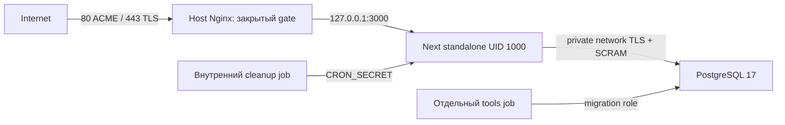

# VPS: решение и модель угроз

Статус: **PROPOSED для ревью**, [Issue #24](https://github.com/bam-low/mgimo/issues/24), 05.11.2026 (UTC). Владелец разрешил подготовку single-VPS пути; покупка, SSH, deploy и открытие доступа не разрешены. A36/standalone сохраняется, условные Vercel Functions + Neon остаются [альтернативой](DEPLOYMENT.md). Продуктовые права A20–A40 не меняются. Полный набор учебных модулей не появился.

## Схема и границы доверия

Приложение имеет две Compose-сети: `edge` для loopback-публикации и `private internal:true` для БД. БД подключена только к `private`, не имеет `ports`. Docker 29 не публикует порты контейнера, имеющего только internal-сеть; это проверено локально, поэтому одна сеть отвергнута. `edge` разрешает исходящие соединения приложения; это не sandbox против RCE/SSRF. Внешний сервис/CDN перед Nginx не предусмотрен. На публичных интерфейсах не должно быть слушателей 3000/5432; Docker ≥28 необходим из-за исторической доступности loopback-портов из соседней L2-сети. UFW сам по себе не защищает опубликованные Docker-порты.

Nginx закрывает `/`, auth, API, static и cleanup одним `auth_basic` в `location /`. Этот дополнительный пароль не заменяет Better Auth. HTTP обслуживает только ACME и canonical redirect; default HTTP — 444, default TLS — `ssl_reject_handshake`. Alternate DNS/IP не получает приложение. До запуска app gate проверяют с выключенным app: анонимный запрос обязан получать 401, не 200/502. Непроверенный конфиг не reload, app не стартует.

Nginx **перезаписывает** `X-Campus-Client-IP`, XFF, X-Real-IP через `$remote_addr`, Host — заданным FQDN, protocol — HTTPS. Нет `real_ip_header`, доверия входящему XFF или универсальным proxy ranges. App доверяет только `x-campus-client-ip`; Loopback доступен локальным процессам, не только root: host admin/локальные пользователи и процессы входят в доверенную ingress-границу. На VPS не размещать чужие приложения/shell accounts. Offsite account только forced read-only SFTP/chroot с DisableForwarding, без shell и туннелей; key-only SSH сам по себе этого не обеспечивает. Смена ingress/CDN требует нового review. Edge rate limit привязан к IP; серверные per-source/per-account счётчики и существующий cleanup сохранены. NAT может объединять посетителей; лимиты не являются защитой от распределённой атаки.

## Образы, роли, секреты

- Runtime: проверенный Next standalone, официальный Node **24.22.1** binary и pinned `distroless/cc-debian13` rootfs. Не содержит shell/npm/Prisma CLI/Studio/alpha/owner scripts. `image-check.mjs` проверяет файлы/ссылки/ключи; существующий standalone checker проверяет граф, canary secrets и dev/alpha-пакеты перед упаковкой. Node binary bookworm → Debian 13 совместимость проверяется реальным HTTPS E2E и PG adapter, не только версиями. Final runtime не наследует слои build Node/npm.
- Tools: отдельный pinned Node bookworm образ с Prisma **7.10.1**, migration/seed и девятью ранее разрешёнными dev-only Studio alpha-зависимостями. Только одноразовый `ops` profile; не web-service, без портов. `check-release.mjs` запрещает tools как app по immutable ID, image role label и UID. Изоляция образов не делает инструменты безвредными: их оператор доверенный, shell/CLI в tools присутствуют.
- `campus_admin` — bootstrap superuser, только PG/owner ops; `campus_migrator` — владелец одной DB, без superuser/CREATEDB/CREATEROLE/INHERIT; `campus_runtime` — LOGIN без ownership/DDL/TEMP/memberships/обхода RLS, лимит 12 соединений. Повтор bootstrap проверяет пароль, не сбрасывает. Проверенный grant/check переиспользует `launch-db-policy.mjs`, включая immutable audit trigger и запрет UPDATE/DELETE AuditLog. Neon hostname-validator не ослаблен: новый VPS adapter требует `db`, private CA и `sslmode=verify-full`.
- БД **17.11** в pinned PostgreSQL 17 image: TLS с SAN `db`, проверка CA/имени, host/local SCRAM, non-TLS host reject. Серверный key root:999/0640. CA private key не монтируется в PG/app. CA/server certificate имеют срок; нужен календарь обновления до истечения, без отключения TLS.
- Все host secrets вне Git/образов/артефактов, `/etc/campus/secrets` root 0700, отдельные файлы root:1000/0640 или root:999/0640. Compose secrets в обычном Docker — **файловые bind mounts, не encrypted secret store**. Шифрование диска провайдера не предполагается. App получает только runtime.env и публичный CA; seed/migration/bootstrap доступны исключительно tools. Процесс с RCE может прочитать свой runtime DB/session secret: host security, role limits и отзыв сессий обязательны.

## Бюджет 4 GiB и эксплуатация

| Потребитель | Лимит / предположение |
| --- | --- |
| App | 1 GiB, 1 CPU, Node old space 640 MiB, PID 128, read-only rootfs, tmp/cache по 64 MiB, cap_drop ALL/no-new-privileges |
| PG | 1 GiB, 0.75 CPU, shared_buffers 256 MiB, work_mem 4 MiB, max_connections 40, persistent volume |
| Tools | 768 MiB/0.75 CPU, только на время операции |
| Cleanup | 128 MiB/0.1 CPU, одноразово |
| Host/Nginx/резерв | Примерно 1 GiB при обычной работе; это бюджет, не измерение реального 4 GiB VPS |

Не запускать build/scanner на VPS, не выполнять tools и backup одновременно при нехватке памяти. Compose health/restart, local logs 10 MiB ×3 на контейнер; Nginx safe access log содержит только время/status/method. Journal и error logs также private: неожиданный сбой способен включить метаданные. Host logrotate/journald caps, fail2ban для SSH, unattended security updates и внешняя проверка нужны до GO.

Backups: consistent custom `pg_dump`, age encryption до записи, 7 дней на VPS, ежедневное копирование владельцем на свой компьютер, 30 дней offsite по вручную установленной политике. Безвозмездность предполагает уже имеющийся компьютер/диск, не новый S3. Хранение на одном VPS не DR; остановка VPS не отправит локальную тревогу. Restore только в отдельную DB/volume, с проверкой таблиц, audit trigger, прав и сценария входа. Цель для закрытого конкурса **PROPOSED RPO ≤24h, RTO ≤4h**, подтверждается реальной репетицией владельца.

## Доставка и обновления

Выбран CI artifact → проверка source SHA/успешных CI владельцем → SSHSIG владельца → проверка pinned signer и SHA256 на VPS → ручной `docker load`. Повторяемы pinned inputs/проверки; побитовая воспроизводимость Next BUILD_ID и timestamps не обещается. Проверка происхождения закрепляет фактические image IDs, а не будущую пересборку. CI не подписывает от имени владельца, не получает SSH/GHCR secrets и не выполняет push/deploy. SHA256 без доверенного происхождения не доказывает подлинность. Ключ release подписи отдельный от SSH и offsite age identity; публичный signer устанавливают доверенным каналом при hardening.

Альтернатива **PROPOSED**: private GHCR, CI `packages:write`, VPS classic PAT только `read:packages` и нужный repository access/SSO, digest pull и rotation. Сейчас не используется: добавляет credential на VPS и стоимость/квоты registry; никакие packages/resources этим PR не создаются. Публичный GHCR раскрывает tools и не принят автоматически.

Upgrade: новая проверенная пара image IDs + signed config, backup/offsite/restore до миграции, проверка совместимости схемы, отдельное разрешение, миграции one-shot, runtime grant/check и smoke. Rollback image допустим только при backwards-compatible схеме. Не откатывать миграции автоматически и не делать `down -v`; при несовместимой схеме — остановить app, восстановить копию в новый volume, проверить, переключить после review. Обновление OS security packages не блокируют вечным hold: новый точный package lock фиксируют после patch/reboot/smoke.

## Уязвимости и NO-GO

Локальный Trivy 0.76.2 с официальным checksum: исходный Node bookworm runtime имел 35 HIGH/1 CRITICAL; отвергнут. Минимальный distroless runtime: **1 HIGH, 36 MEDIUM, 8 LOW**, critical 0 (05.11.2026, изменяемая vulnerability DB). HIGH `CVE-2026-76844`, zlib1g, upstream fixed version отсутствует. Это **не автоматически принятое исключение**: до запуска требуется triage достижимости/обновлённого image и решение security review на gate D; без него NO-GO. CI сохраняет полный отчёт и блокирует известные исправимые HIGH/CRITICAL; unfixed не исчезают из отчёта и требуют ручного решения. Production npm audit и OS scan — разные проверки.

## Источники и непроверенные предпосылки

Проверены официальные страницы 05.11.2026: [Fatmetal pricing](https://fatmetal.ru/pricing/vps), [продукт](https://fatmetal.ru/products/vps), [Debian 13](https://www.debian.org/releases/trixie/), [Docker Debian](https://docs.docker.com/engine/install/debian/), [Docker firewall](https://docs.docker.com/engine/network/packet-filtering-firewalls/), [Compose](https://docs.docker.com/reference/compose-file/services/), [distroless](https://github.com/GoogleContainerTools/distroless), [Nginx auth](https://nginx.org/en/docs/http/ngx_http_auth_basic_module.html), [ACME](https://letsencrypt.org/docs/challenge-types/), [GHCR](https://docs.github.com/en/packages/working-with-a-github-packages-registry/working-with-the-container-registry).

Не проверены личный кабинет/договор/платёж, реальная static IPv4/IPv6 и DNS, доступность Debian image/SSH/rescue, реальный apt lock, TLS renewal, память/диск VPS, внешние порты, offsite/alert/RF networks. Локальная проверка не подтверждает эти свойства; порядок и stop points — [runbook](VPS_DEPLOY_RUNBOOK.md), фиксация фактов — [checklist](VPS_LAUNCH_CHECKLIST.md).
