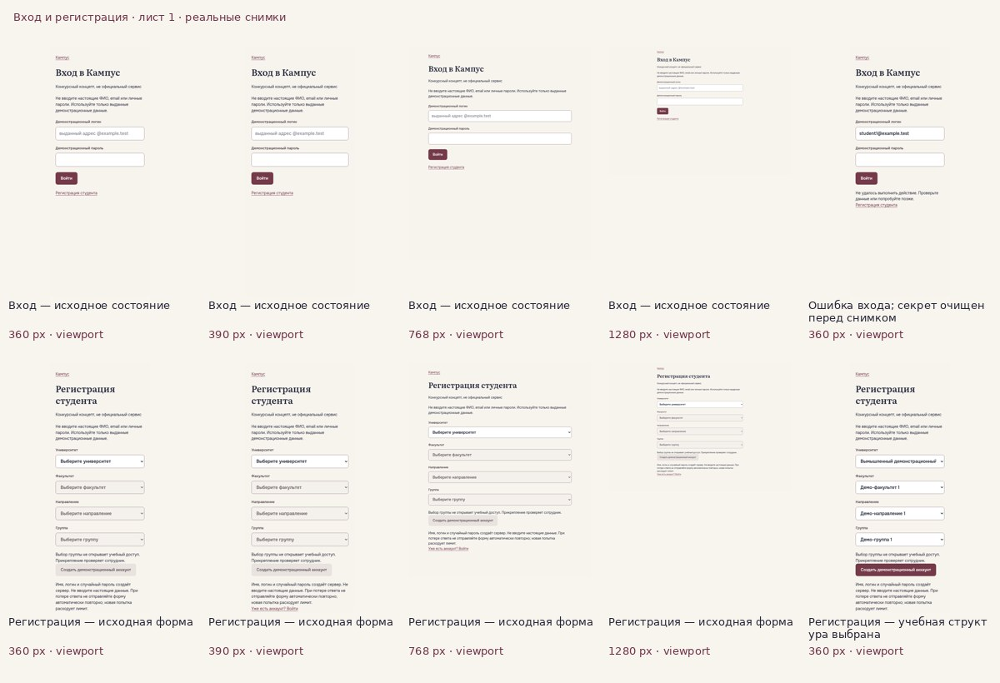
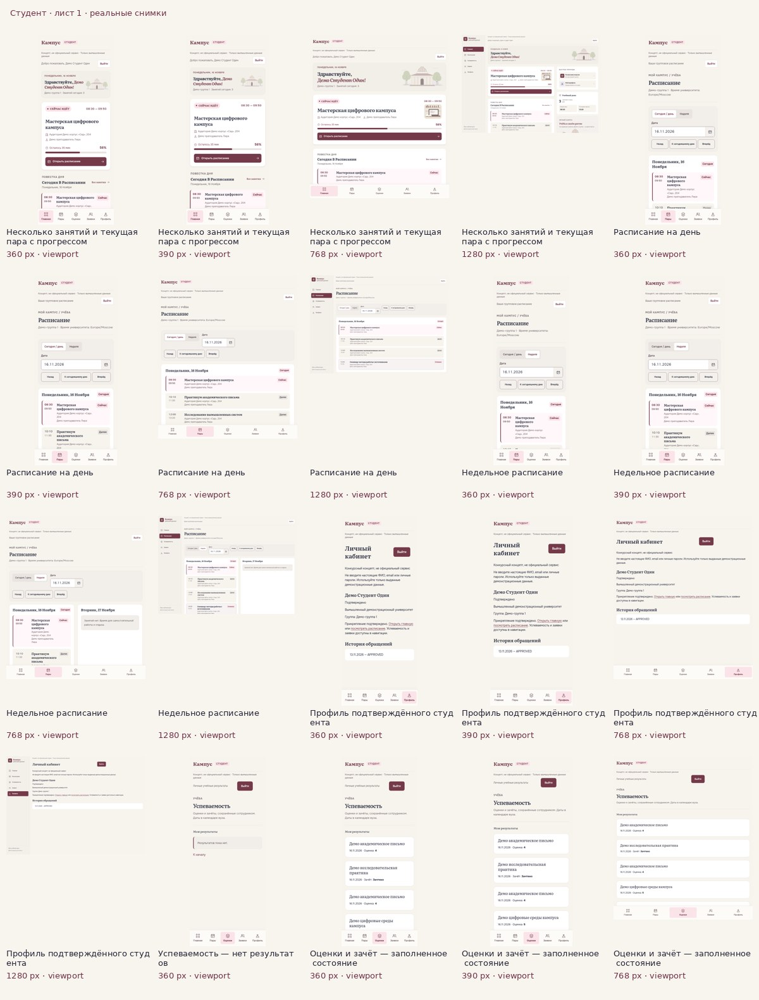
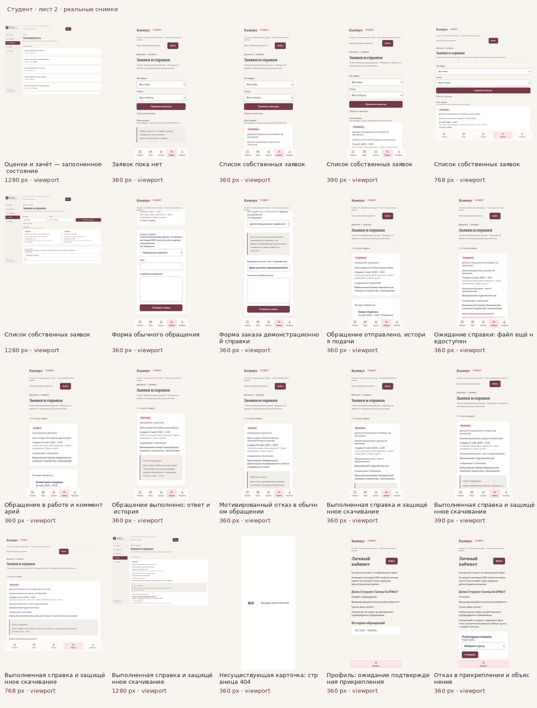
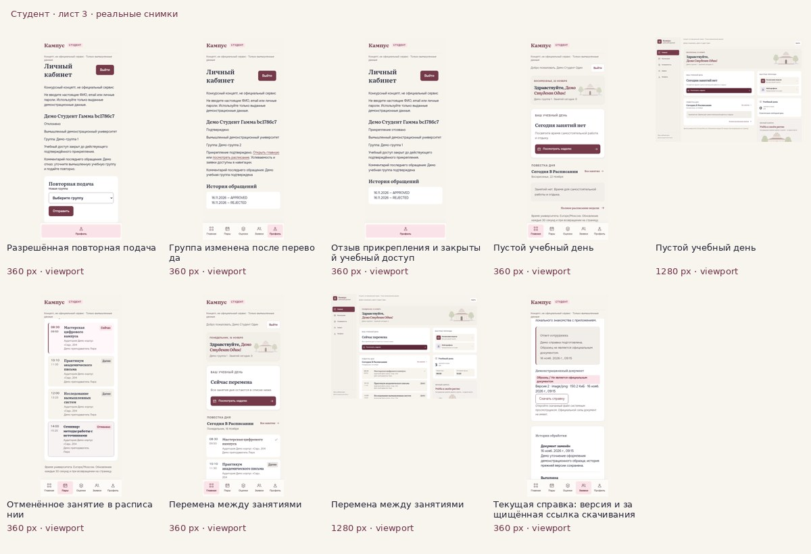
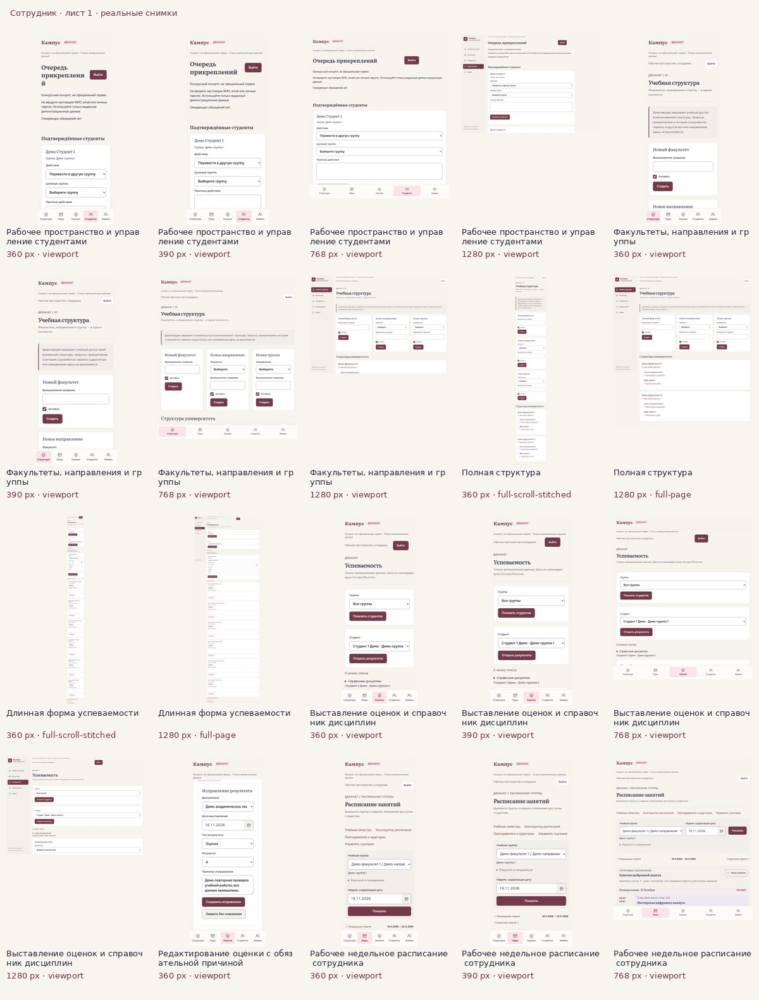
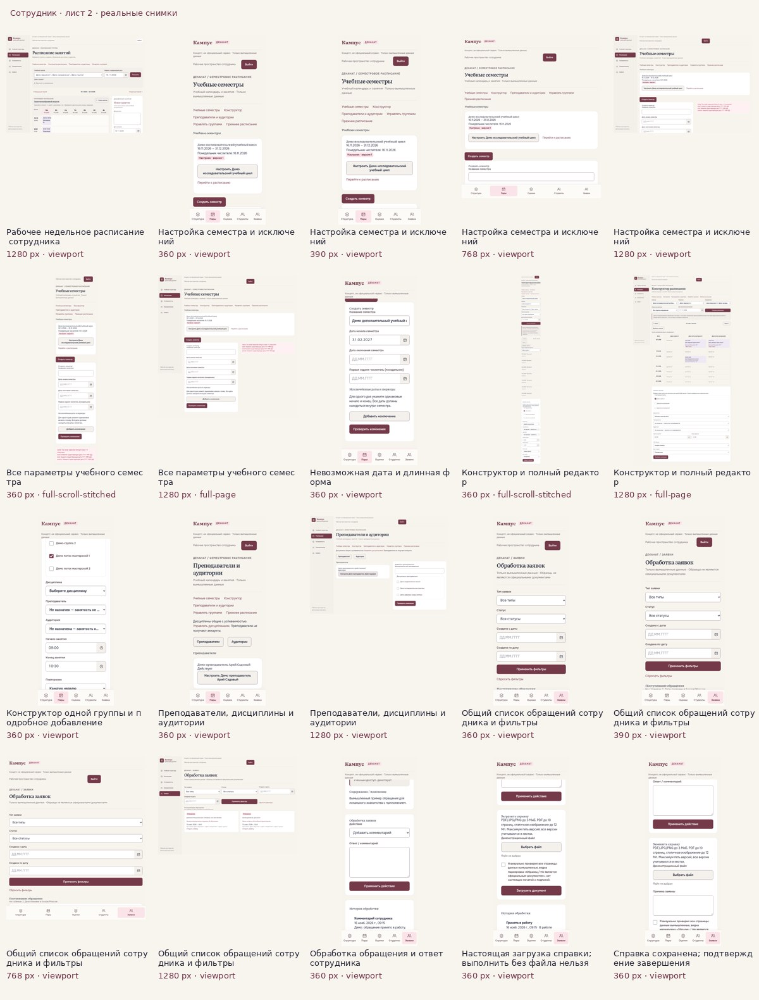
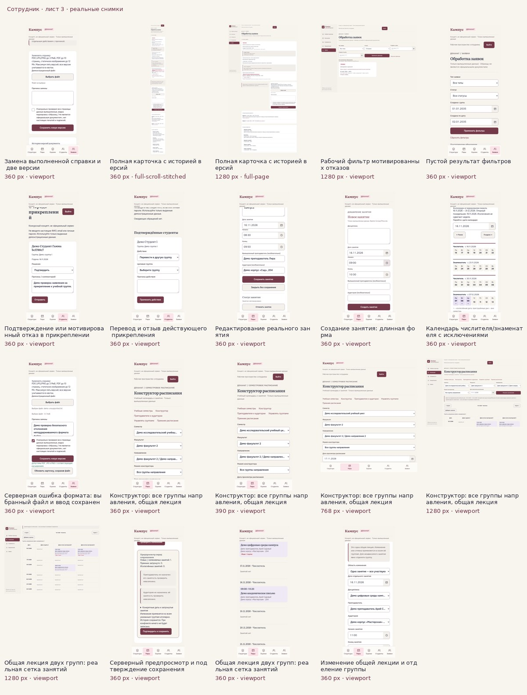

# Кампус — материалы визуального аудита 6.5

**118 настоящих PNG**, ширины 360, 390, 768 и 1280 px. Снято 13.11.2026 из работающего production Next.js на исходном main `f375bee1e329f61200bbafebf34c80bed805c8b1`. Данные и документы вымышленные. Приложение и дизайн не изменялись.

## Открыть галерею

- [Вход и регистрация](public.md).
- [Студент](student.md).
- [Сотрудник](staff.md).
- [Архив всей галереи](campus-audit-6.5.zip): скачать, распаковать и открыть `gallery.html` в браузере. Установка приложения и PostgreSQL не нужна. GitHub не исполняет HTML из репозитория; для просмотра непосредственно на GitHub используйте три ссылки выше.

## Покрытие и выводы

- [Полная матрица покрытия](COVERAGE.md) и [CSV](coverage.csv).
- [Предварительный UX-аудит](UX_AUDIT.md).
- [Не снятые состояния и ограничения](MISSING.md).
- [Диагностика VPS CI](VPS_CI_DIAGNOSIS.md).
- [Происхождение, тестовое время и способ съёмки](PROVENANCE.md).
- [Машиночитаемый каталог с SHA256](manifest.json).

Комплект превышает ориентир 100 кадров, поскольку отдельные кадры нужны для истории прикрепления, обработки справок, серверной ошибки загрузки, A/B-календаря и длинных форм. Побайтно одинаковые кадры объединены; матрица сохраняет соответствующие состояния. Сложные страницы представлены начальным экраном и полным содержимым на 360/1280 px. Мобильные длинные страницы — явно отмеченные механические склейки реальной прокрутки, без изменения CSS.

## Контактные листы

### Вход и регистрация · 1

### Студент · 1

### Студент · 2

### Студент · 3

### Сотрудник · 1

### Сотрудник · 2

### Сотрудник · 3

Production NO-GO сохраняется. Эти материалы не означают функциональную, WCAG или производственную приёмку. Изменения интерфейса требуют отдельного согласования.
