# Сотрудник

[Общий индекс](README.md) · [Матрица покрытия](COVERAGE.md)

Миниатюра открывает настоящий PNG. «Склейка прокрутки» — составное изображение внутренней области страницы; подробнее в [происхождении материалов](PROVENANCE.md).

## Студенты

| Состояние | Размер и формат | Снимок |
| --- | --- | --- |
| Рабочее пространство и управление студентами | 360 px · экран 900 px | [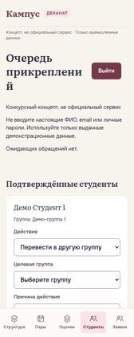](png/staff-home-360-viewport.png) |
| Рабочее пространство и управление студентами | 390 px · экран 900 px | [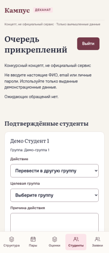](png/staff-home-390-viewport.png) |
| Рабочее пространство и управление студентами | 768 px · экран 900 px | [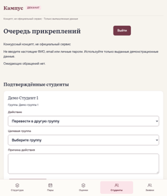](png/staff-home-768-viewport.png) |
| Рабочее пространство и управление студентами | 1280 px · экран 900 px | [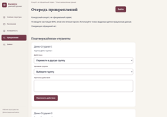](png/staff-home-1280-viewport.png) |
| Подтверждение или мотивированный отказ в прикреплении | 360 px · экран 900 px | [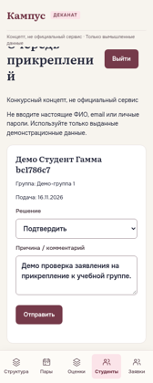](png/staff-membership-decision-360-viewport.png) |
| Перевод и отзыв действующего прикрепления | 360 px · экран 900 px | [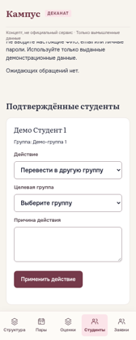](png/staff-membership-transfer-360-viewport.png) |

## Структура

| Состояние | Размер и формат | Снимок |
| --- | --- | --- |
| Факультеты, направления и группы | 360 px · экран 900 px | [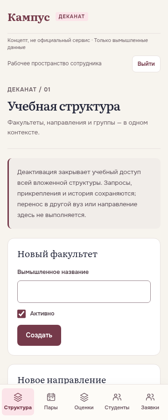](png/staff-structure-360-viewport.png) |
| Факультеты, направления и группы | 390 px · экран 900 px | [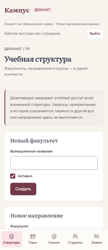](png/staff-structure-390-viewport.png) |
| Факультеты, направления и группы | 768 px · экран 900 px | [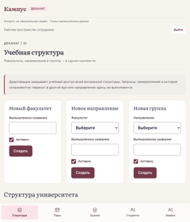](png/staff-structure-768-viewport.png) |
| Факультеты, направления и группы | 1280 px · экран 900 px | [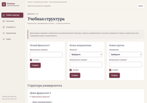](png/staff-structure-1280-viewport.png) |
| Полная структура | 360 px · склейка прокрутки | [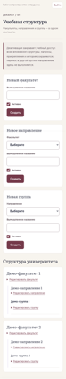](png/staff-structure-360-full.png) |
| Полная структура | 1280 px · полная страница | [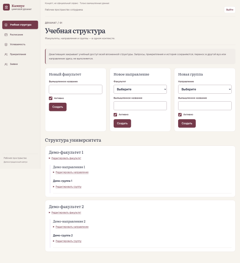](png/staff-structure-1280-full.png) |

## Успеваемость

| Состояние | Размер и формат | Снимок |
| --- | --- | --- |
| Длинная форма успеваемости | 360 px · склейка прокрутки | [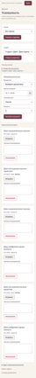](png/staff-grades-360-full.png) |
| Длинная форма успеваемости | 1280 px · полная страница | [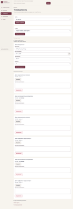](png/staff-grades-1280-full.png) |
| Выставление оценок и справочник дисциплин | 360 px · экран 900 px | [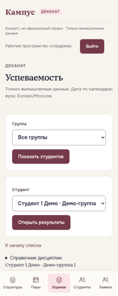](png/staff-grades-360-viewport.png) |
| Выставление оценок и справочник дисциплин | 390 px · экран 900 px | [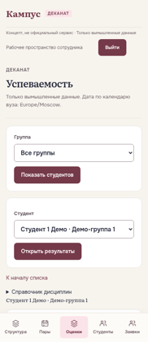](png/staff-grades-390-viewport.png) |
| Выставление оценок и справочник дисциплин | 768 px · экран 900 px | [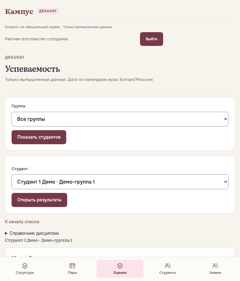](png/staff-grades-768-viewport.png) |
| Выставление оценок и справочник дисциплин | 1280 px · экран 900 px | [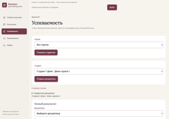](png/staff-grades-1280-viewport.png) |
| Редактирование оценки с обязательной причиной | 360 px · экран 900 px | [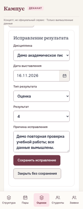](png/staff-grade-edit-360-viewport.png) |

## Расписание

| Состояние | Размер и формат | Снимок |
| --- | --- | --- |
| Рабочее недельное расписание сотрудника | 360 px · экран 900 px | [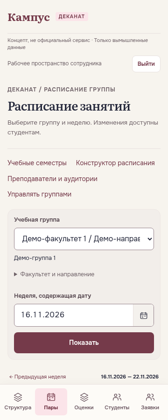](png/staff-schedule-360-viewport.png) |
| Рабочее недельное расписание сотрудника | 390 px · экран 900 px | [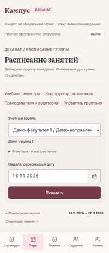](png/staff-schedule-390-viewport.png) |
| Рабочее недельное расписание сотрудника | 768 px · экран 900 px | [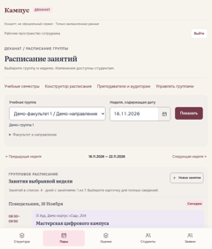](png/staff-schedule-768-viewport.png) |
| Рабочее недельное расписание сотрудника | 1280 px · экран 900 px | [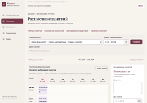](png/staff-schedule-1280-viewport.png) |
| Редактирование реального занятия | 360 px · экран 900 px | [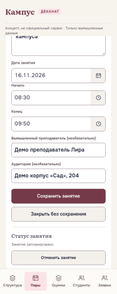](png/staff-lesson-edit-360-viewport.png) |
| Создание занятия: длинная форма | 360 px · экран 900 px | [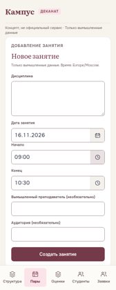](png/staff-lesson-create-360-viewport.png) |

## Семестр

| Состояние | Размер и формат | Снимок |
| --- | --- | --- |
| Настройка семестра и исключений | 360 px · экран 900 px | [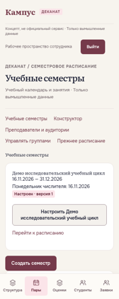](png/staff-semesters-360-viewport.png) |
| Настройка семестра и исключений | 390 px · экран 900 px | [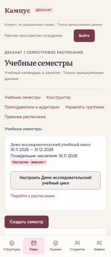](png/staff-semesters-390-viewport.png) |
| Настройка семестра и исключений | 768 px · экран 900 px | [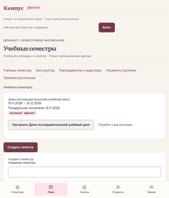](png/staff-semesters-768-viewport.png) |
| Настройка семестра и исключений | 1280 px · экран 900 px | [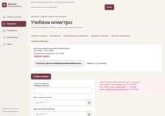](png/staff-semesters-1280-viewport.png) |
| Все параметры учебного семестра | 360 px · склейка прокрутки | [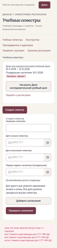](png/staff-semesters-360-full.png) |
| Все параметры учебного семестра | 1280 px · полная страница | [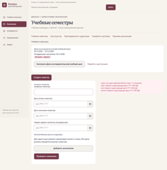](png/staff-semesters-1280-full.png) |
| Невозможная дата и длинная форма | 360 px · экран 900 px | [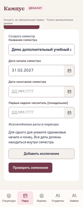](png/staff-semester-validation-360-viewport.png) |
| Календарь числителя/знаменателя с исключениями | 360 px · экран 900 px | [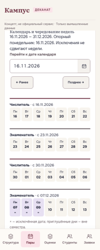](png/staff-ab-calendar-360-viewport.png) |

## Конструктор

| Состояние | Размер и формат | Снимок |
| --- | --- | --- |
| Конструктор и полный редактор | 360 px · склейка прокрутки |  |
| Конструктор и полный редактор | 1280 px · полная страница | [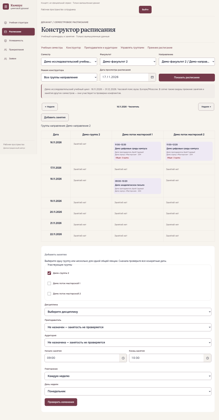](png/staff-builder-all-1280-full.png) |
| Конструктор одной группы и подробное добавление | 360 px · экран 900 px | [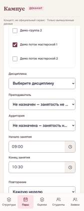](png/staff-builder-one-360-viewport.png) |
| Конструктор: все группы направления, общая лекция | 360 px · экран 900 px | [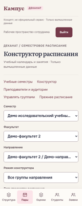](png/staff-builder-all-360-viewport.png) |
| Конструктор: все группы направления, общая лекция | 390 px · экран 900 px | [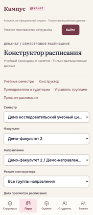](png/staff-builder-all-390-viewport.png) |
| Конструктор: все группы направления, общая лекция | 768 px · экран 900 px | [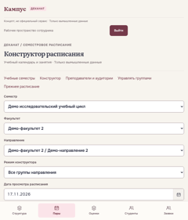](png/staff-builder-all-768-viewport.png) |
| Конструктор: все группы направления, общая лекция | 1280 px · экран 900 px | [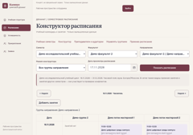](png/staff-builder-all-1280-viewport.png) |
| Общая лекция двух групп: реальная сетка занятий | 1280 px · экран 900 px | [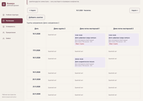](png/staff-shared-lecture-1280-viewport.png) |
| Серверный предпросмотр и подтверждение сохранения | 360 px · экран 900 px | [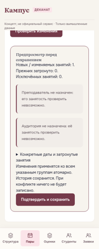](png/staff-builder-confirmation-360-viewport.png) |
| Общая лекция двух групп: реальная сетка занятий | 360 px · экран 900 px | [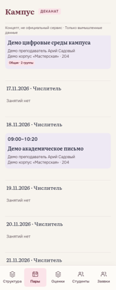](png/staff-shared-lecture-360-viewport.png) |
| Изменение общей лекции и отделение группы | 360 px · экран 900 px | [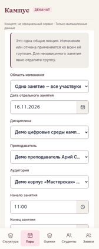](png/staff-shared-edit-360-viewport.png) |

## Справочники

| Состояние | Размер и формат | Снимок |
| --- | --- | --- |
| Преподаватели, дисциплины и аудитории | 360 px · экран 900 px | [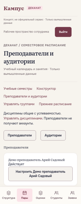](png/staff-resources-360-viewport.png) |
| Преподаватели, дисциплины и аудитории | 1280 px · экран 900 px | [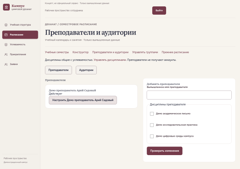](png/staff-resources-1280-viewport.png) |

## Заявки

| Состояние | Размер и формат | Снимок |
| --- | --- | --- |
| Общий список обращений сотрудника и фильтры | 360 px · экран 900 px | [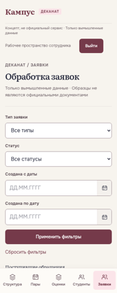](png/staff-applications-360-viewport.png) |
| Общий список обращений сотрудника и фильтры | 390 px · экран 900 px | [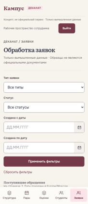](png/staff-applications-390-viewport.png) |
| Общий список обращений сотрудника и фильтры | 768 px · экран 900 px | [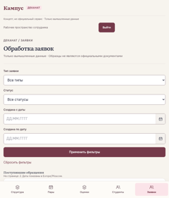](png/staff-applications-768-viewport.png) |
| Общий список обращений сотрудника и фильтры | 1280 px · экран 900 px | [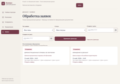](png/staff-applications-1280-viewport.png) |
| Обработка обращения и ответ сотрудника | 360 px · экран 900 px | [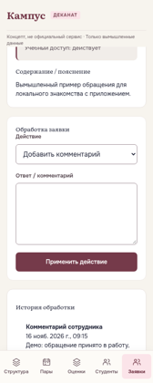](png/staff-application-process-360-viewport.png) |
| Рабочий фильтр мотивированных отказов | 1280 px · экран 900 px |  |
| Пустой результат фильтров | 360 px · экран 900 px |  |

## Справки

| Состояние | Размер и формат | Снимок |
| --- | --- | --- |
| Настоящая загрузка справки; выполнить без файла нельзя | 360 px · экран 900 px |  |
| Справка сохранена; подтверждение завершения | 360 px · экран 900 px |  |
| Замена выполненной справки и две версии | 360 px · экран 900 px |  |
| Полная карточка с историей версий | 360 px · склейка прокрутки |  |
| Полная карточка с историей версий | 1280 px · полная страница |  |

## Ошибки

| Состояние | Размер и формат | Снимок |
| --- | --- | --- |
| Серверная ошибка формата: выбранный файл и ввод сохранены | 360 px · экран 900 px |  |
