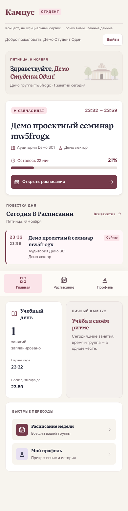
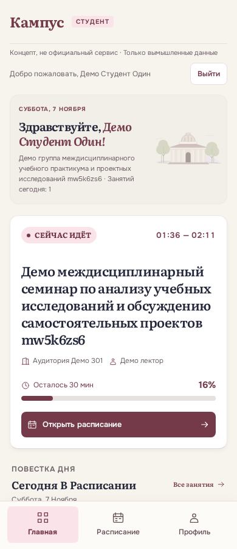
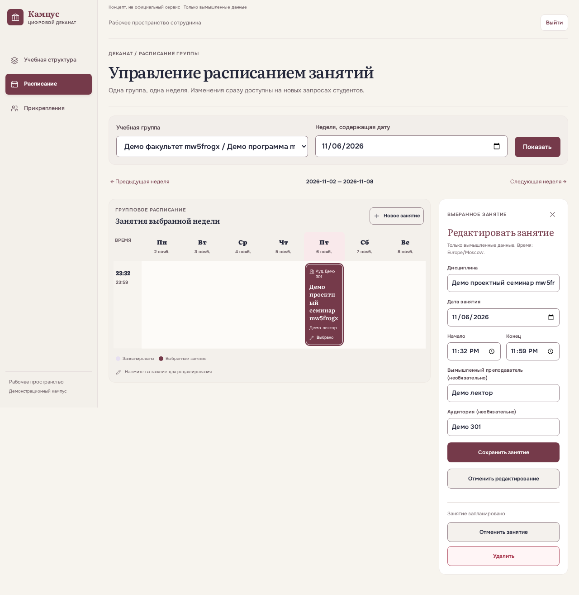
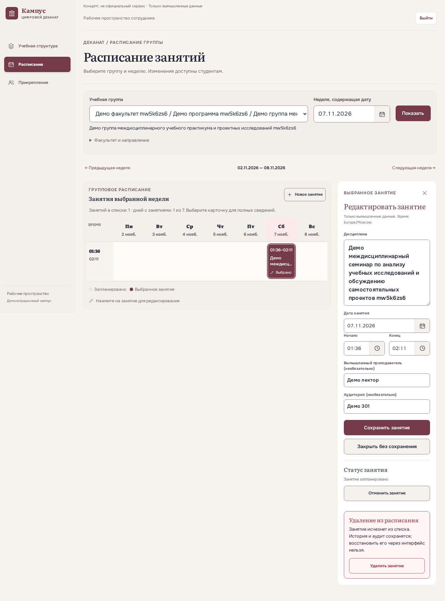

# Дизайн-ревью07.11 — реальные сравнительные screenshots

Доработка существующего [Draft PR #35](https://github.com/bam-low/mgimo/pull/35). [Матрица P0/P1 и границы проверок](../../../design/UI_REVIEW_2026-11-07.md). Все данные исключительно вымышленные. Baseline `7208c2d` сохранён в родительской папке; новый набор не заменяет утверждённые Figma PNG и не меняет иллюстрации.

## До / после

| Сценарий | До (`7208c2d`) | После |
| --- | --- | --- |
| STUDENT360 | [Full-page](../student-360.png) | [Viewport](student-360-viewport.png) / [Full-page](student-360-full.png) / [Конец scrollport](student-360-end.png) |
| STUDENT390 | [Full-page](../student-390.png) | [Viewport](student-390-viewport.png) / [Full-page](student-390-full.png) / [Конец](student-390-end.png) |
| STUDENT1280 | [Full-page](../student-1280.png) | [Viewport](student-1280-viewport.png) / [Full-page](student-1280-full.png) |
| STAFF360 | [Full-page](../staff-360.png) | [Viewport](staff-360-viewport.png) / [Full-page](staff-360-full.png) / [Календарь](staff-360-calendar.png) / [Inspector](staff-360-inspector.png) / [Конец](staff-360-end.png) |
| STAFF390 | [Full-page](../staff-390.png) | [Viewport](staff-390-viewport.png) / [Full-page](staff-390-full.png) / [Календарь](staff-390-calendar.png) / [Inspector](staff-390-inspector.png) / [Конец](staff-390-end.png) |
| STAFF1280 | [Full-page](../staff-1280.png) | [Viewport](staff-1280-viewport.png) / [Full-page](staff-1280-full.png) |

Новая съёмка намеренно использует более длинные названия группы/дисциплины, чем baseline, для проверки P0. Это новые fixtures отдельной тестовой БД, не обновление существующих пользовательских/конкурсных данных. Серверное время настоящее, поэтому даты/прогресс не совпадают с ранними снимками. Сравниваем компоновку и доступность, не побитовое совпадение разных данных.

Mobile nav находится в собственной строке, контент — в scrollport. Full-page900px показывает полный документ приложения; все длинные карточки доступны прокруткой **внутри Workspace**. Кадры конца показывают доступность последних элементов выше nav; отдельные calendar/inspector кадры показывают длинные строки/формы. Никаких временных CSS override, скрытия nav ради съёмки или stitching.

## Визуальное сравнение

| STUDENT390 — baseline full-page | STUDENT390 — новый viewport |
| --- | --- |
|  |  |

| STAFF1280 — baseline | STAFF1280 — compact grid, русские поля и полный inspector |
| --- | --- |
|  |  |

## Несколько пар, пустой день и сокращённый viewport

- Реальный seed, три занятия: [360](student-multiple-360.png), [390](student-multiple-390.png), [1280](student-multiple-1280.png).
- Реальный день без занятий: [1280](student-empty-1280.png).
- Сфокусированное поле при viewport height420: [STAFF360](staff-360-reduced-viewport.png), [STAFF390](staff-390-reduced-viewport.png). Это тест resize/visualViewport, **не настоящий снимок мобильной клавиатуры**.

Новый state-тест проверяет before/current/break/after и реальный monotonic переход через конец пары с контролируемым test-only serverNow; эти clock fixtures не выдаются за отдельные DB E2E и не используются как основной screenshot evidence. Существующие regression guards/auth/audit/409/auto-refresh сохраняются.

Локально PASS:11unit,44integration,11artifact-checker/7launch-helper/15VPS helper; standalone11E2E, Functions12E2E+cold start, VPS11HTTPS E2E+TLS/SCRAM/backup restore; обе сборки и runtime isolation, lint/typecheck/docs/diff. Production audit0, полный13moderate dev. Remote3CI на новом SHA публикуются отдельно в описании того же PR. Full WCAG/screenreader, реальная iOS/Android keyboard/safe-area и финальное визуальное утверждение ещё вручную. Production NO-GO сохраняется.
