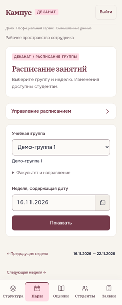
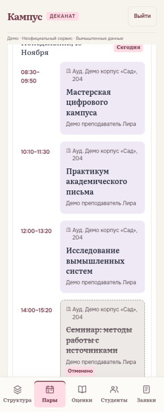
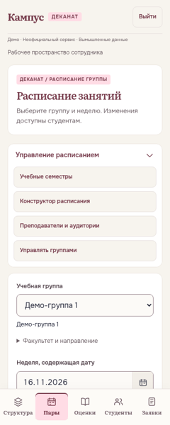
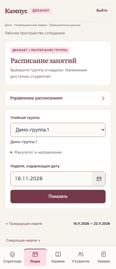
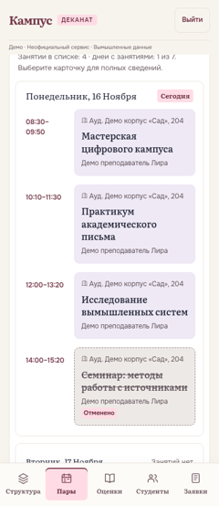
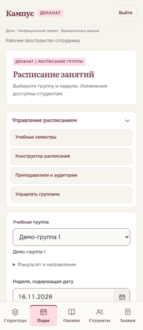
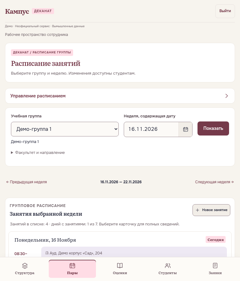
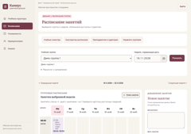

# Мобильное уточнение расписания — PR #47

Владелец принял визуальное направление как основу, сохранив ручное утверждение PR. По следующему поручению изменены только переходы и селект группы на странице расписания сотрудника.

- До 1100 px четыре служебных перехода находятся в нативном раскрытии «Управление расписанием», исходно закрытом. Высота закрытого блока на 360/390/768 — 50 px. Поддерживаются Enter и обычный клик.
- На 1280 px сохранён горизонтальный ряд ссылок.
- В селекте — название группы; полная цепочка факультета/направления остаётся в раскрытии. Белые карточки, палитра, шрифты, «Выйти» и нижняя навигация сохранены.

## Настоящие снимки

| Ширина | Верх страницы | Первый день с занятиями | Раскрытые переходы |
| --- | --- | --- | --- |
| 360 |  |  |  |
| 390 |  |  |  |
| 768 |  | Проверка планшетной компоновки | Компактное раскрытие |
| 1280 |  | Контроль desktop | Горизонтальный ряд |

[Полные факультет и направление на 360](png/staff-schedule-group-context-360-viewport.png).

## Проверки и происхождение

Девять PNG настоящего production Next.js и Chromium; отдельные вымышленные PostgreSQL fixtures прежнего аудита. Для воспроизводимого расписания внешние часы задают 16.11.2026, 10:30 по Москве. CSS/DOM/API для снимков не подменялись. Все изображения — обычный viewport 900 CSS px по высоте, без склейки.

[Измерения четырёх ширин](layout-checks.json): document и workspace без горизонтального переполнения, нижняя навигация отделена от прокрутки, «Выйти» на линии бренда. На 360/390 дополнительно проверено раскрытие/сворачивание клавишей Enter и доступность всех четырёх ссылок; полный контекст группы сохранён. [Размеры и SHA256 PNG](manifest.json).

Секреты, пароли, cookies и токены не включены. [Ранее подготовленная полная галерея](../issue-46/README.md) показывает предыдущую итерацию, этот документ содержит актуальную точечную правку. [Диагностика CI и предложения на согласование](../../CI_DIAGNOSIS_PR47.md).

PR остаётся Draft, Production NO-GO сохраняется. Merge/auto-merge/deploy не выполнялись.

Локально также пройдены lint, TypeScript, production build/standalone artifact gate, 19 unit и 71 PostgreSQL integration. Закрытая локальная VPS-репетиция нового мобильного runtime: 16 E2E и encrypted fresh restore PASS. Диагностические Functions baseline PR: 17 E2E PASS. Это локальные результаты, не исправление ранее красных GitHub CI и не production GO.

## Контроль перехода к дню — 14.11.2026

[Настоящий снимок 360 px](day-navigation-360.png), [шаги и координаты](day-navigation-360.json). При переходе к первому дню с занятиями заголовок виден целиком ниже шапки; перекрытие не воспроизведено. Компоновка не менялась.
