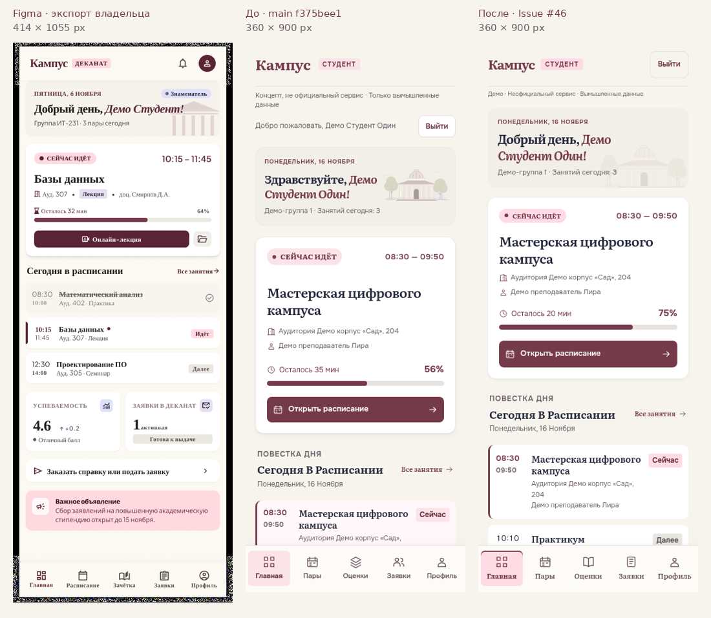
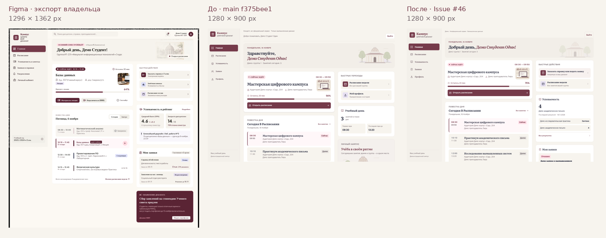
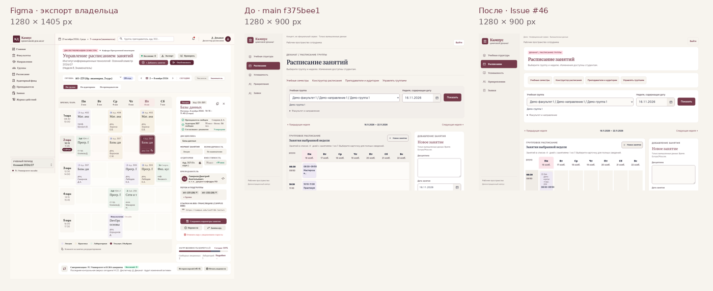

# Приближение интерфейса к Figma — Issue #46

**64 настоящих снимка** работающего интерфейса на 360/390/768/1280 px, пять контактных листов и три сравнения с Figma. Исходная main — `f375bee1e329f61200bbafebf34c80bed805c8b1`, изменения — ветка `feat/figma-visual-alignment`. Дата: 13.11.2026. Только вымышленные данные.

Актуальное мобильное уточнение расписания: [9 новых кадров и измерения](../issue-46-mobile-review/README.md). Снимки и архив ниже относятся к предыдущей визуальной итерации; другие разделы не перерабатывались.

## Просмотр

- [Студент](student.md): главная, расписание, результаты, заявки, справка и профиль.
- [Сотрудник](staff.md): студенты, структура, расписание и редактирование, конструктор, семестры, справочники, оценки, заявки и версии справки.
- [Публичные страницы](public.md): начало, вход, регистрация и русская 404.
- [Архив с автономной HTML-галереей и PNG](campus-ui-46.zip). Скачать, распаковать, открыть `gallery.html`; приложение устанавливать не требуется. На самом GitHub HTML не исполняется, используйте три Markdown-галереи выше.
- [Матрица покрытия](COVERAGE.md) / [CSV](coverage.csv).
- [Что изменено и что сохранено](REVIEW.md), [происхождение](PROVENANCE.md), [ограничения](LIMITATIONS.md), [проверки](CI.md).

Выйти теперь можно из общей шапки, на одной линии с «Кампусом»; повторных кнопок в содержимом нет. Положение проверяется на четырёх ширинах.

## Сравнение с переданными Figma-экспортами

Слева — оригинальный экспорт, в центре — настоящая предыдущая версия из аудита PR #45, справа — новая. Изображения только пропорционально уменьшены и расположены рядом. Размеры фрейма и viewport различаются, поэтому это визуальная сверка композиции, а не попиксельный diff. Длинные названия и содержимое зависят от реальных вымышленных записей.

### Главная студента — мобильный экран

### Главная студента — десктоп

### Расписание сотрудника

Исходные три PNG: [inventory](../../design/ASSET_INVENTORY_V3.md). Прямой Figma CONNECT сейчас возвращает 403; актуальная онлайн-ревизия не подтверждена. Для страниц без отдельного фрейма применяется тот же визуальный язык к существующим работающим сценариям.

Production NO-GO сохраняется. Визуальное утверждение, merge и deploy не выполнялись.
