# Сотрудник

[Общий индекс](README.md) · [Матрица покрытия](COVERAGE.md)

Миниатюра открывает настоящий PNG. «Склейка прокрутки» — составное изображение внутренней области страницы; подробнее в [происхождении материалов](PROVENANCE.md).

## Расписание

| Состояние | Размер и формат | Снимок |
| --- | --- | --- |
| Выбранное занятие и действующий редактор | 1280 px · полная страница | [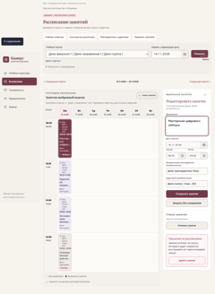](png/staff-schedule-selected-1280-full.png) |
| Расписание: сетка и редактор | 360 px · экран 900 px | [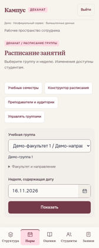](png/staff-schedule-360-viewport.png) |
| Расписание: сетка и редактор | 390 px · экран 900 px | [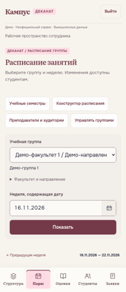](png/staff-schedule-390-viewport.png) |
| Расписание: сетка и редактор | 768 px · экран 900 px | [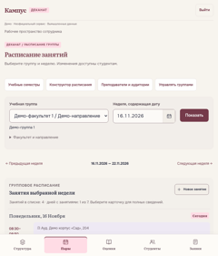](png/staff-schedule-768-viewport.png) |
| Расписание: сетка и редактор | 1280 px · экран 900 px | [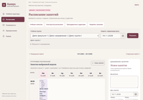](png/staff-schedule-1280-viewport.png) |
| Редактирование занятия на мобильном | 360 px · экран 900 px | [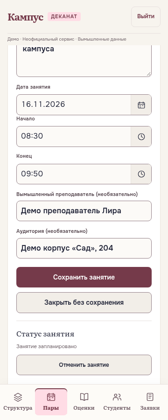](png/staff-lesson-edit-360-viewport.png) |

## Студенты

| Состояние | Размер и формат | Снимок |
| --- | --- | --- |
| Очередь и подтверждённые студенты | 360 px · экран 900 px | [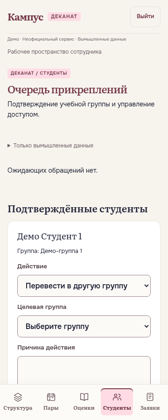](png/staff-home-360-viewport.png) |
| Очередь и подтверждённые студенты | 1280 px · экран 900 px | [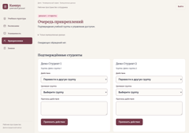](png/staff-home-1280-viewport.png) |

## Структура

| Состояние | Размер и формат | Снимок |
| --- | --- | --- |
| Факультеты, направления и группы | 360 px · экран 900 px | [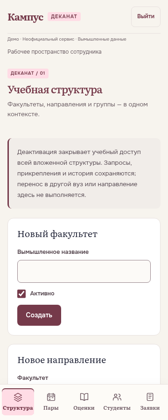](png/staff-structure-360-viewport.png) |
| Факультеты, направления и группы | 1280 px · экран 900 px | [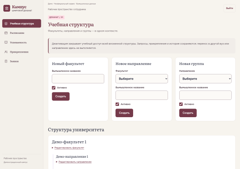](png/staff-structure-1280-viewport.png) |

## Семестр

| Состояние | Размер и формат | Снимок |
| --- | --- | --- |
| Учебные семестры и календарь | 360 px · экран 900 px | [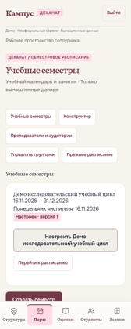](png/staff-semesters-360-viewport.png) |
| Учебные семестры и календарь | 1280 px · экран 900 px | [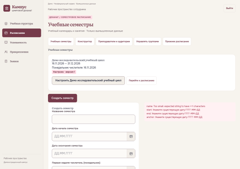](png/staff-semesters-1280-viewport.png) |
| Числитель, знаменатель и исключённые даты | 360 px · экран 900 px | [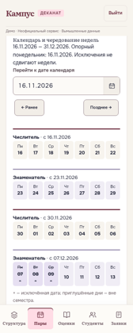](png/staff-ab-calendar-360-viewport.png) |
| Числитель, знаменатель и исключённые даты | 1280 px · экран 900 px | [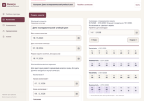](png/staff-ab-calendar-1280-viewport.png) |

## Успеваемость

| Состояние | Размер и формат | Снимок |
| --- | --- | --- |
| Выбор студента и дисциплины | 360 px · экран 900 px | [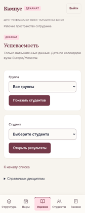](png/staff-grades-360-viewport.png) |
| Выбор студента и дисциплины | 1280 px · экран 900 px | [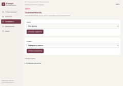](png/staff-grades-1280-viewport.png) |

## Заявки

| Состояние | Размер и формат | Снимок |
| --- | --- | --- |
| Обработка и фильтры заявок | 360 px · экран 900 px | [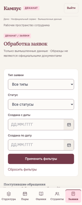](png/staff-applications-360-viewport.png) |
| Обработка и фильтры заявок | 1280 px · экран 900 px | [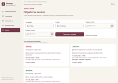](png/staff-applications-1280-viewport.png) |

## Справочники

| Состояние | Размер и формат | Снимок |
| --- | --- | --- |
| Преподаватели и аудитории | 360 px · экран 900 px | [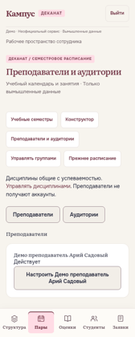](png/staff-resources-360-viewport.png) |
| Преподаватели и аудитории | 1280 px · экран 900 px | [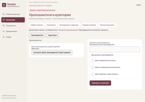](png/staff-resources-1280-viewport.png) |

## Конструктор

| Состояние | Размер и формат | Снимок |
| --- | --- | --- |
| Конструктор: фильтры и загруженная сетка | 360 px · экран 900 px | [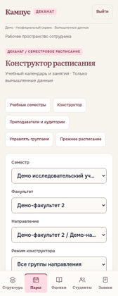](png/staff-builder-360-viewport.png) |
| Конструктор: фильтры и загруженная сетка | 390 px · экран 900 px | [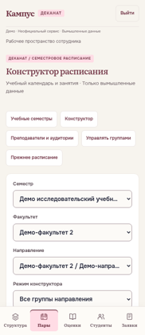](png/staff-builder-390-viewport.png) |
| Конструктор: фильтры и загруженная сетка | 768 px · экран 900 px | [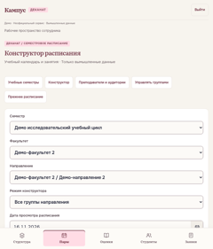](png/staff-builder-768-viewport.png) |
| Конструктор: фильтры и загруженная сетка | 1280 px · экран 900 px | [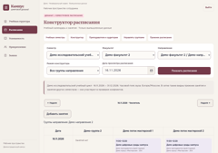](png/staff-builder-1280-viewport.png) |
| Общая лекция: мобильный список | 360 px · экран 900 px | [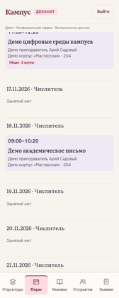](png/staff-shared-lecture-360-viewport.png) |
| Одна группа: подробный редактор занятия | 360 px · экран 900 px | [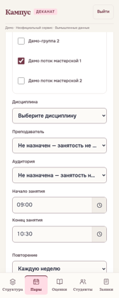](png/staff-builder-one-360-viewport.png) |

## Справки

| Состояние | Размер и формат | Снимок |
| --- | --- | --- |
| Справка: загрузка, замена и история версий | 360 px · экран 900 px | [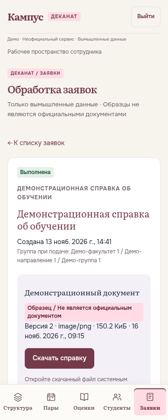](png/staff-certificate-history-360-viewport.png) |
| Справка: загрузка, замена и история версий | 1280 px · экран 900 px | [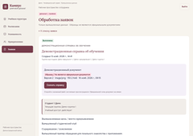](png/staff-certificate-history-1280-viewport.png) |
