# Студент

[Общий индекс](README.md) · [Матрица покрытия](COVERAGE.md)

Миниатюра открывает настоящий PNG. «Склейка прокрутки» — составное изображение внутренней области страницы; подробнее в [происхождении материалов](PROVENANCE.md).

## Главная

| Состояние | Размер и формат | Снимок |
| --- | --- | --- |
| Главная целиком | 1280 px · полная страница | [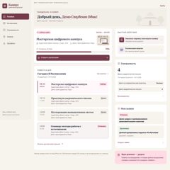](png/student-today-current-1280-full.png) |
| Главная: полная прокрутка | 360 px · склейка прокрутки | [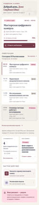](png/student-today-current-360-full.png) |
| Главная: реальная пара, оценки и заявки | 360 px · экран 900 px | [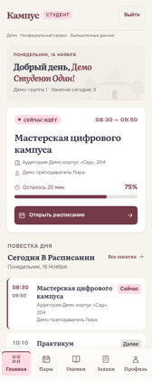](png/student-today-current-360-viewport.png) |
| Главная: реальная пара, оценки и заявки | 390 px · экран 900 px | [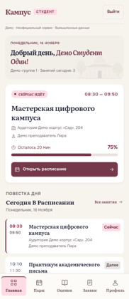](png/student-today-current-390-viewport.png) |
| Главная: реальная пара, оценки и заявки | 768 px · экран 900 px | [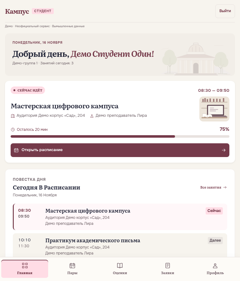](png/student-today-current-768-viewport.png) |
| Главная: реальная пара, оценки и заявки | 1280 px · экран 900 px | [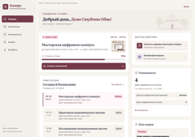](png/student-today-current-1280-viewport.png) |

## Расписание

| Состояние | Размер и формат | Снимок |
| --- | --- | --- |
| Моё расписание | 360 px · экран 900 px | [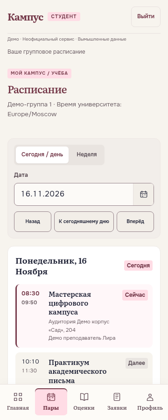](png/student-schedule-360-viewport.png) |
| Моё расписание | 390 px · экран 900 px | [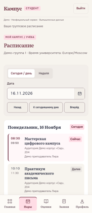](png/student-schedule-390-viewport.png) |
| Моё расписание | 768 px · экран 900 px | [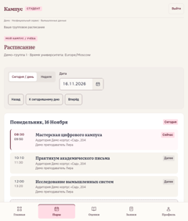](png/student-schedule-768-viewport.png) |
| Моё расписание | 1280 px · экран 900 px | [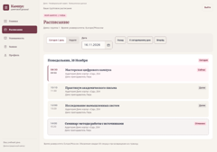](png/student-schedule-1280-viewport.png) |

## Успеваемость

| Состояние | Размер и формат | Снимок |
| --- | --- | --- |
| Собственные учебные результаты | 360 px · экран 900 px | [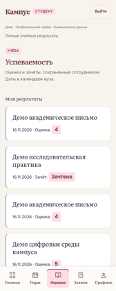](png/student-grades-360-viewport.png) |
| Собственные учебные результаты | 390 px · экран 900 px | [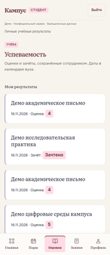](png/student-grades-390-viewport.png) |
| Собственные учебные результаты | 768 px · экран 900 px | [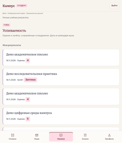](png/student-grades-768-viewport.png) |
| Собственные учебные результаты | 1280 px · экран 900 px | [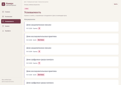](png/student-grades-1280-viewport.png) |

## Заявки

| Состояние | Размер и формат | Снимок |
| --- | --- | --- |
| Список заявок и создание обращения | 360 px · экран 900 px | [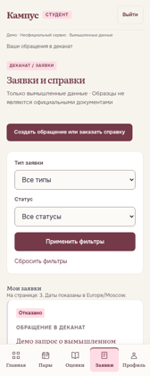](png/student-applications-360-viewport.png) |
| Список заявок и создание обращения | 390 px · экран 900 px | [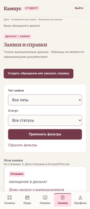](png/student-applications-390-viewport.png) |
| Список заявок и создание обращения | 768 px · экран 900 px | [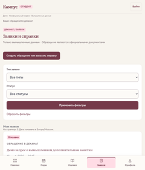](png/student-applications-768-viewport.png) |
| Список заявок и создание обращения | 1280 px · экран 900 px | [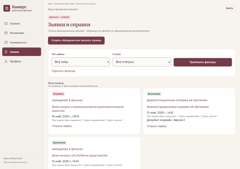](png/student-applications-1280-viewport.png) |
| Форма обращения: рабочий переход с главной | 360 px · экран 900 px | [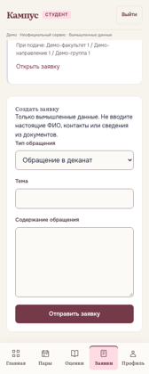](png/student-compose-360-viewport.png) |

## Справки

| Состояние | Размер и формат | Снимок |
| --- | --- | --- |
| Выполненная справка: скачивание в верхней части карточки | 360 px · экран 900 px | [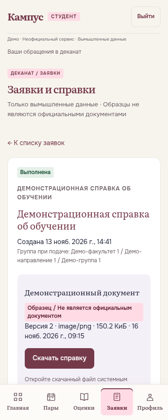](png/student-certificate-360-viewport.png) |
| Выполненная справка: скачивание в верхней части карточки | 390 px · экран 900 px | [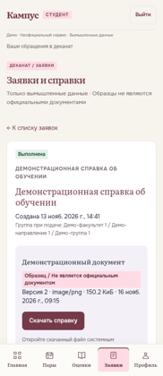](png/student-certificate-390-viewport.png) |
| Выполненная справка: скачивание в верхней части карточки | 768 px · экран 900 px | [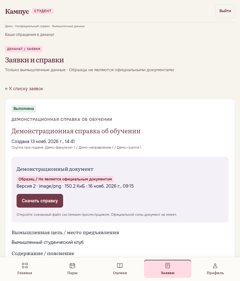](png/student-certificate-768-viewport.png) |
| Выполненная справка: скачивание в верхней части карточки | 1280 px · экран 900 px | [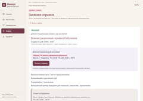](png/student-certificate-1280-viewport.png) |

## Профиль

| Состояние | Размер и формат | Снимок |
| --- | --- | --- |
| Профиль и подтверждённая группа | 360 px · экран 900 px | [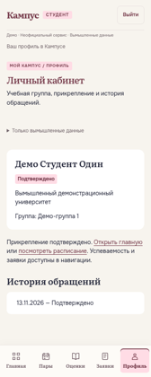](png/student-profile-360-viewport.png) |
| Профиль и подтверждённая группа | 1280 px · экран 900 px | [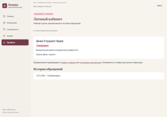](png/student-profile-1280-viewport.png) |
