# Этап 7 — настоящие скриншоты уведомлений

16 viewport PNG из запущенного Next.js/Chromium/PostgreSQL на вымышленных данных, 14.11.2026. Сняты Playwright после ожидания готовой страницы/локальных шрифтов, без склеек и подмены HTML. Паролей/cookies/tokens/настоящих документов нет. Ширины 360/390/768/1280, высота 900; проверены общий/workspace overflow и линия верхнего выхода.

| Состояние | 360 px | 390 px | 768 px | 1280 px |
| --- | --- | --- | --- | --- |
| Пустая лента | [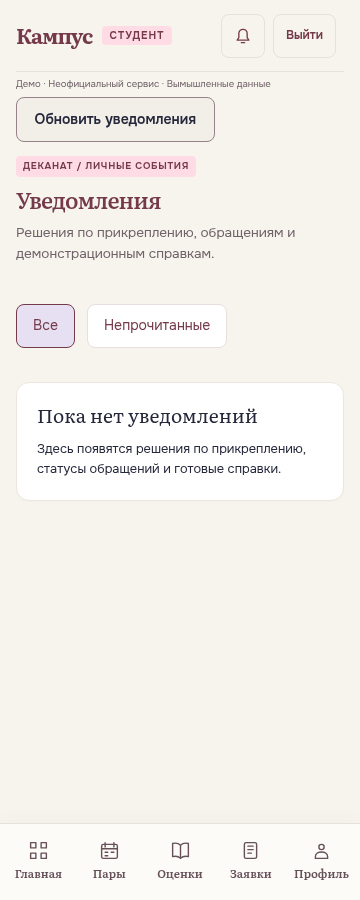](notifications-empty-360.png) | [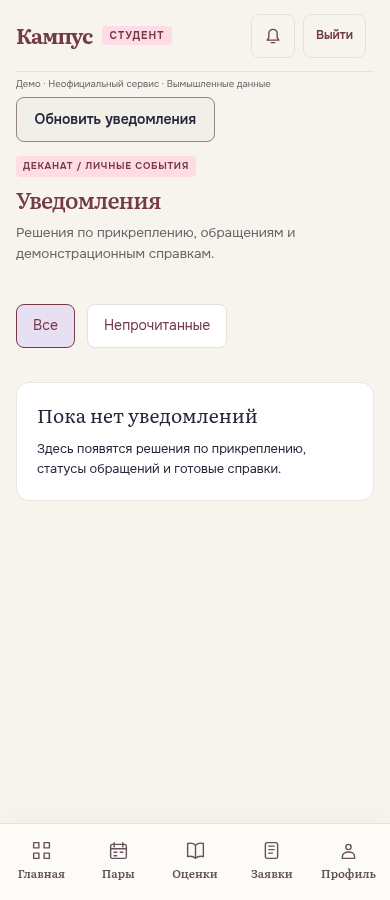](notifications-empty-390.png) | [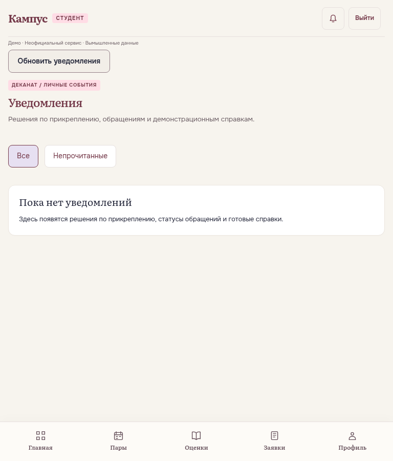](notifications-empty-768.png) | [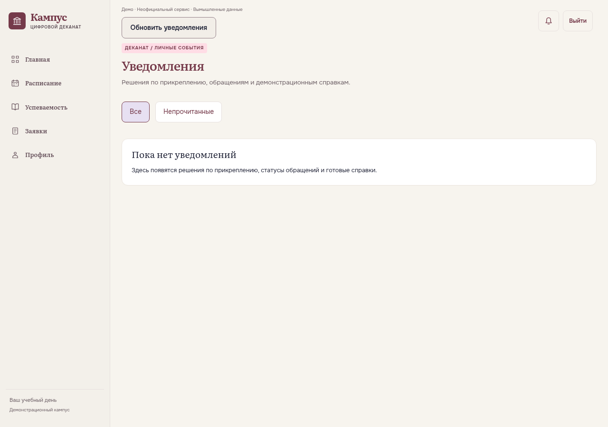](notifications-empty-1280.png) |
| Непрочитанные | [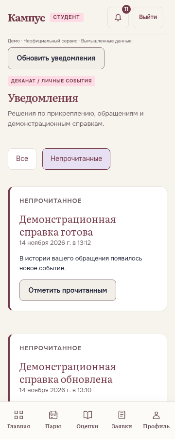](notifications-unread-360.png) | [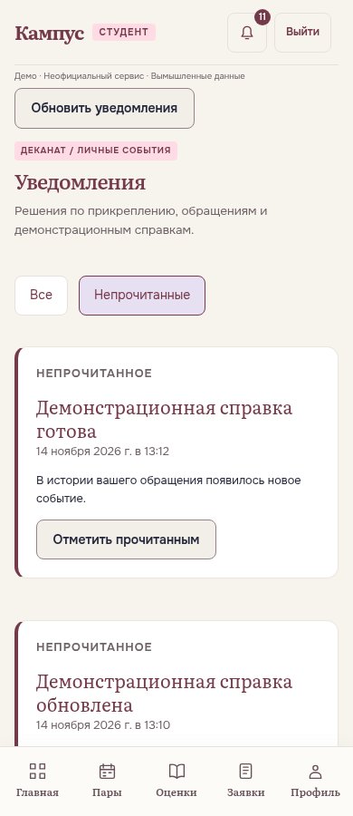](notifications-unread-390.png) | [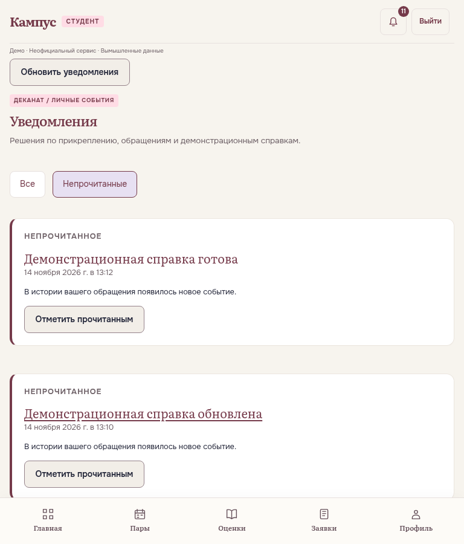](notifications-unread-768.png) | [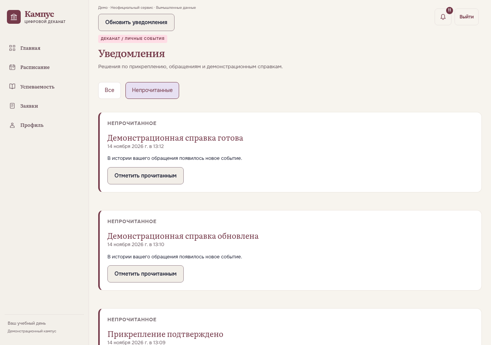](notifications-unread-1280.png) |
| Готовая справка / прочтение | [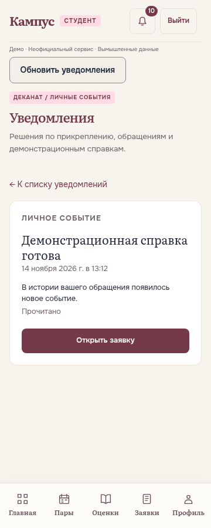](notifications-ready-360.png) | [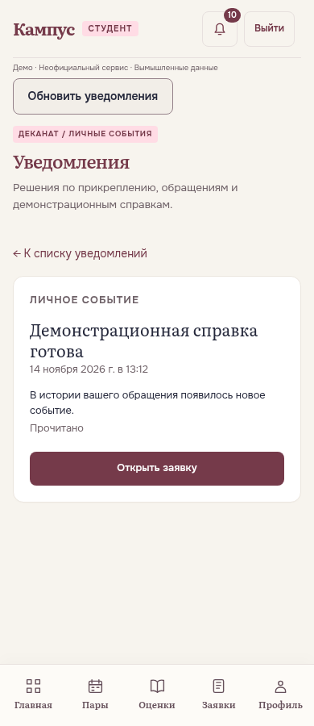](notifications-ready-390.png) | [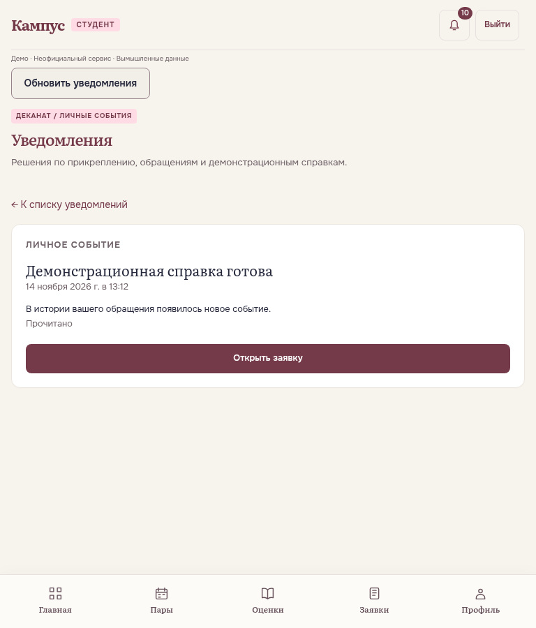](notifications-ready-768.png) | [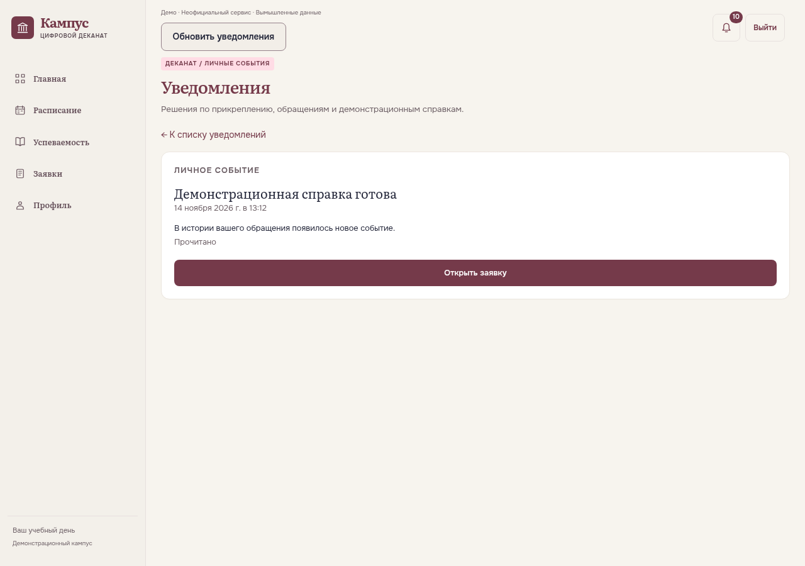](notifications-ready-1280.png) |
| После отзыва прикрепления | [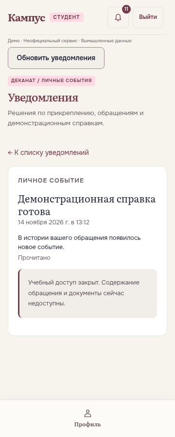](notifications-revoked-360.png) | [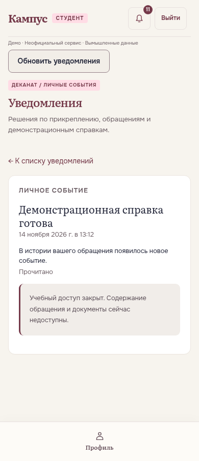](notifications-revoked-390.png) | [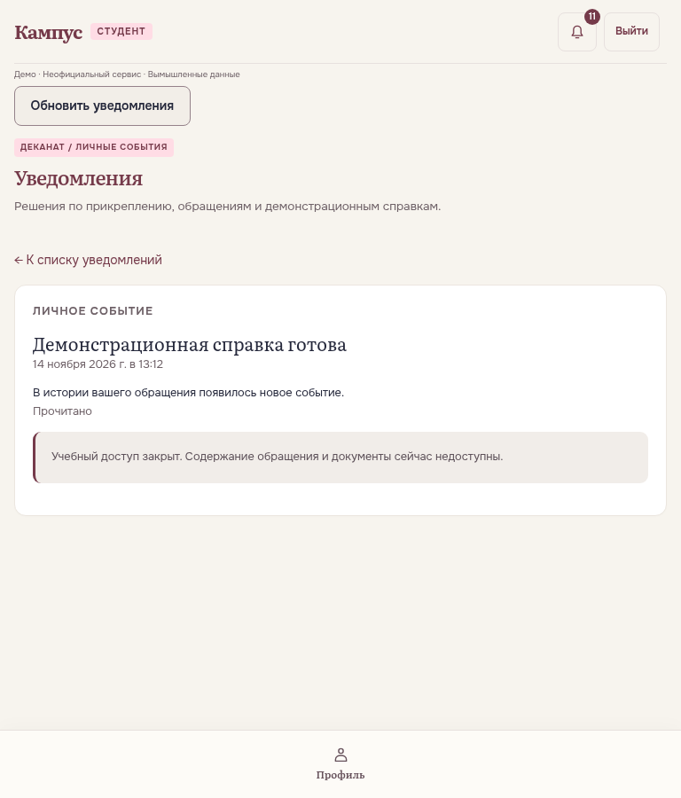](notifications-revoked-768.png) | [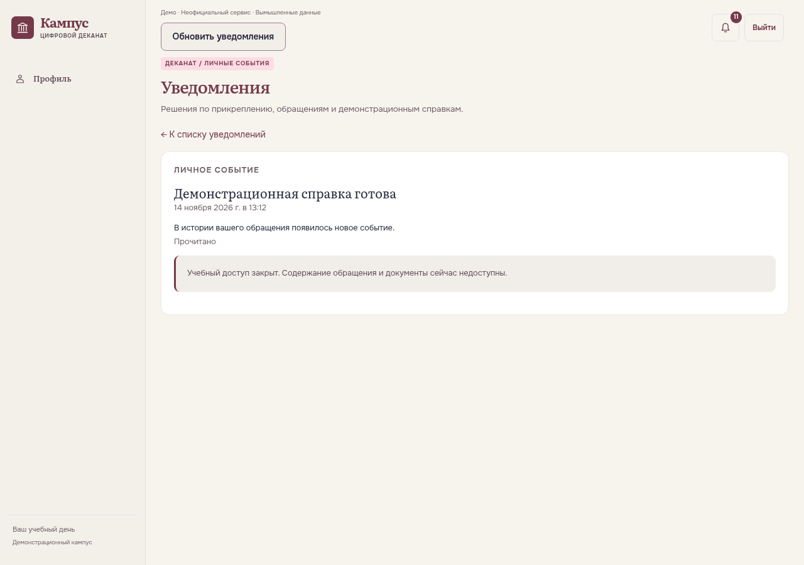](notifications-revoked-1280.png) |

[Матрица файлов/размеров/SHA256](manifest.json). В состоянии после отзыва общая карточка остаётся доступна, но кнопка заявки отсутствует; прямые API заявки и скачивания проверены403. После штатного восстановления учебный доступ возвращается, readAt сохраняется. Эти кадры не являются независимой приёмкой физических устройств/WCAG; production NO-GO сохраняется.
