# Расписание → успеваемость — сквозная проверка PR #65

Уточнение раздела «Связь с успеваемостью» Issue #62, 18.11.2026. Настоящие Chromium, production standalone Next.js и отдельная PostgreSQL `*_test`; только вымышленные данные, без макетов и подмен HTTP-ответов. Точный итоговый SHA и три CI указаны в описании PR #65.

Сценарий создаёт Subject в настоящей форме «Дисциплины и группы», назначает группе А и затем использует тот же ID при выставлении результата. Публиковать занятие для этого не требуется. Два студента с разными membership проверяются настоящими сессиями.

## Матрица сквозного результата

| Проверка | Подтверждение |
| --- | --- |
| Один Subject в расписании и успеваемости | ID из UI-запроса создания совпал с каталогом назначения и запросом записи оценки; копия дисциплины не создавалась |
| До выбора группы нет выбора студента/нового результата | Поле disabled, форма результата отсутствует |
| В группе А нет студента Б | Проверен список option, затем прямой поддельный POST для А со студентом Б дал 409 |
| Смена А → Б | Старый студент, форма, тип результата, дисциплина и курсоры сброшены; новая форма начинается без прежней дисциплины |
| Успешная оценка | POST 200, настоящий результат отображается, защищённый GET возвращает нужный membership/Subject |
| Перевод между открытием и сохранением | Другой STAFF-контекст перевёл студента; прежняя форма получила 409, записи нет, ввод сохранён |
| История после перевода | Список собственных результатов до/после совпал целиком; оба результата доступны нужному студенту |
| IDOR при одной текущей группе | Второй студент не увидел оценки первого даже после их прикрепления к одной группе; чужой membership в GET →403 |
| Явное исправление после перевода | Режим истории позволил STAFF изменить 4 на 3 с причиной; один GRADE_EDIT в аудите, студент увидел 3 |
| Регрессии | Числа и журналы в [новом отчёте](../../../reports/issue-62/grade-link/README.md), не подменяются старыми результатами adcffdf |

## Дисциплина создана из расписания и назначена группе А

### 1280 px

[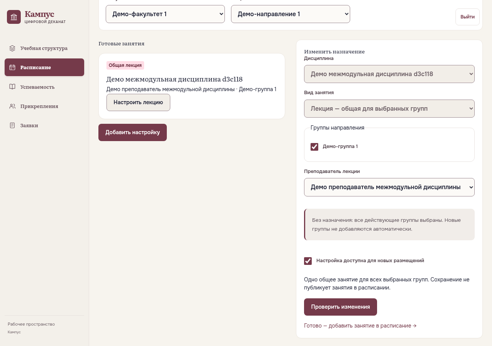](01-subject-assigned-1280.png)

### 360 px

[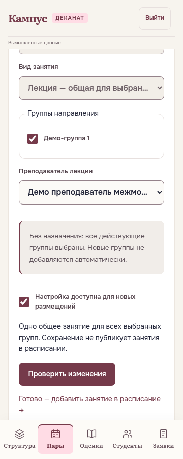](01-subject-assigned-360.png)

## Без группы студент и новый результат недоступны

### 1280 px

[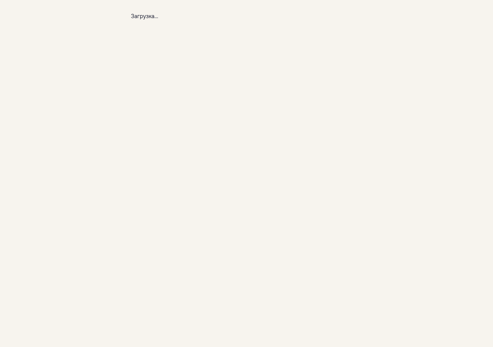](02-group-required-1280.png)

### 360 px

[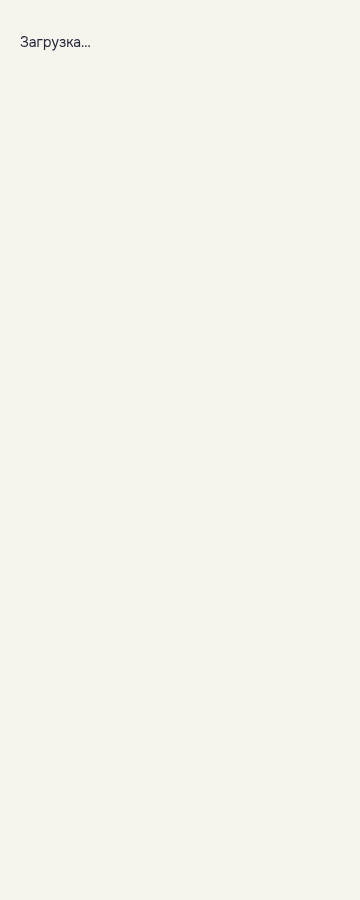](02-group-required-360.png)

## Выбрана группа А: список только её студентов

### 1280 px

### 360 px

[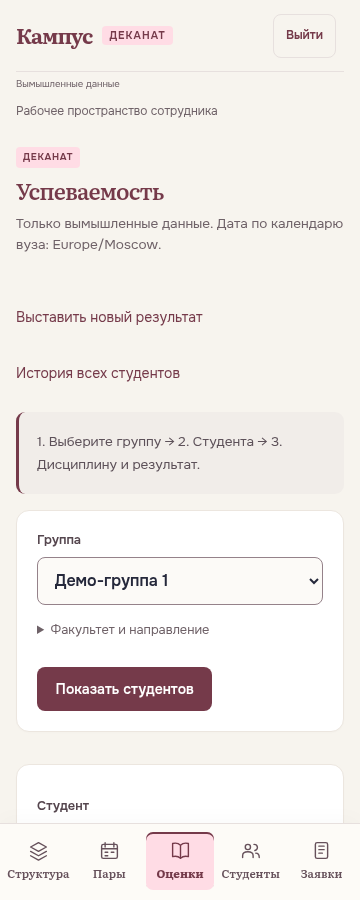](03-group-a-roster-360.png)

## Новый результат по тому же Subject

### 1280 px

[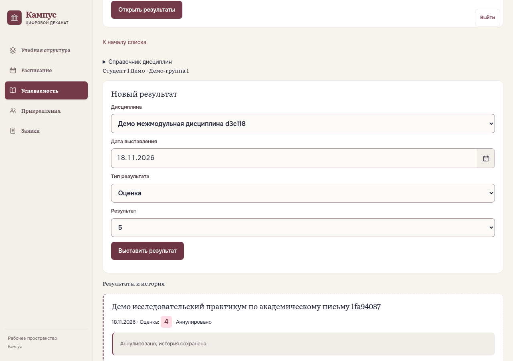](04-same-subject-result-1280.png)

### 360 px

[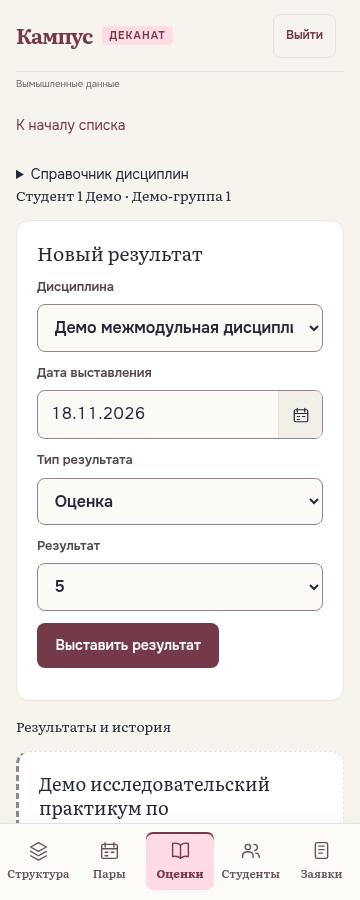](04-same-subject-result-360.png)

## Смена группы сбросила студента и форму

### 1280 px

[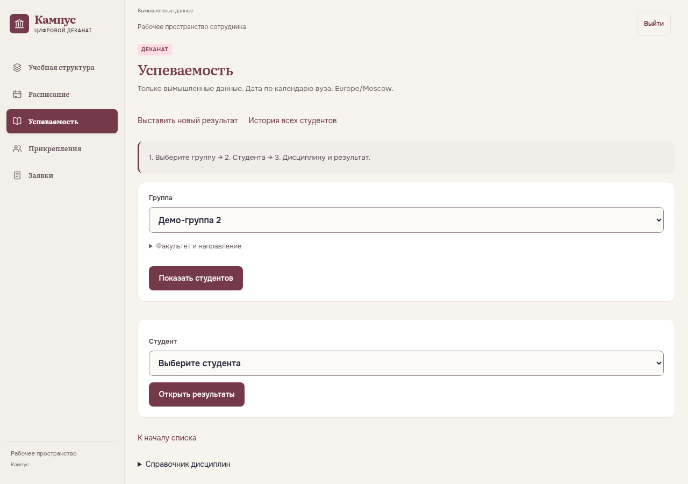](05-group-change-reset-1280.png)

### 360 px

[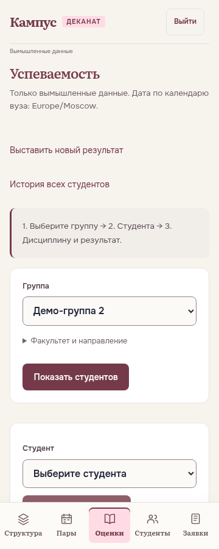](05-group-change-reset-360.png)

## После перевода сервер отказал старой форме, ввод сохранён

### 1280 px

[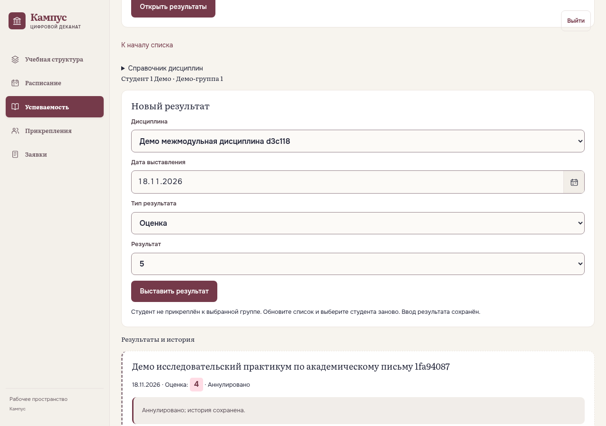](06-stale-transfer-refused-1280.png)

### 360 px

[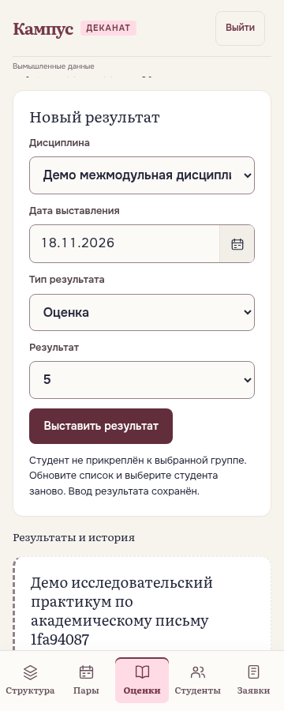](06-stale-transfer-refused-360.png)

## Студент видит собственную историю после перевода

### 360 px

[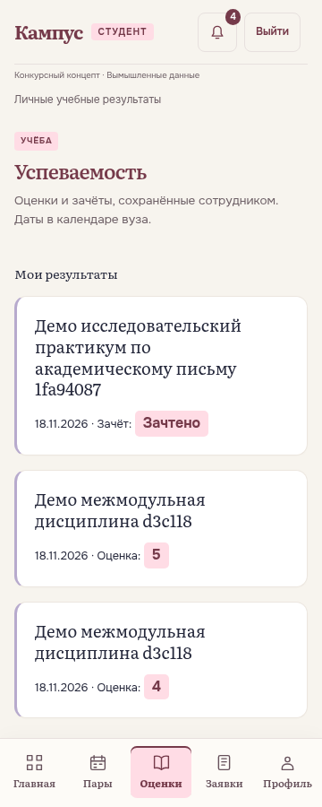](07-student-own-history-360.png)

## Сотрудник видит историю после перевода

### 1280 px

[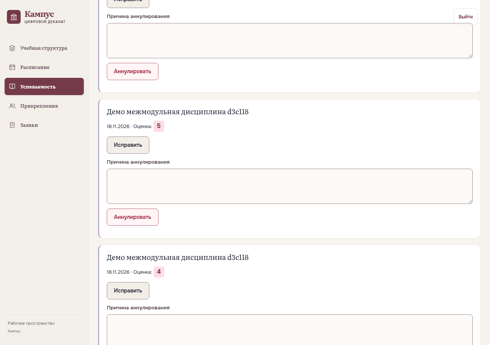](08-history-after-transfer-1280.png)

### 360 px

[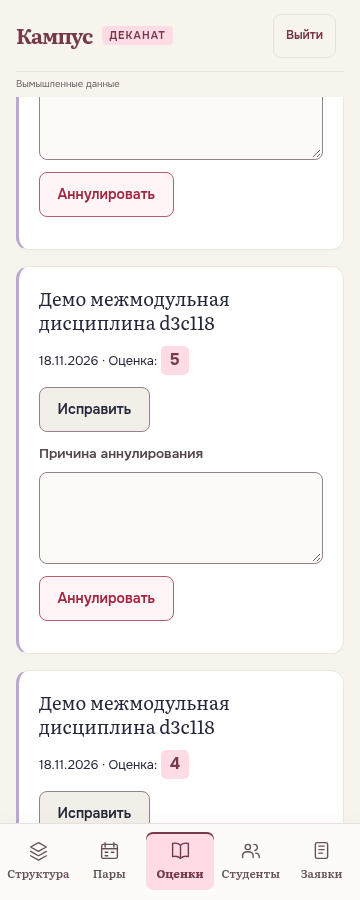](08-history-after-transfer-360.png)

## Ограничения

Проверка выполнена агентом в браузере; она не заменяет пользовательскую приёмку человеком без подсказок. Физические устройства и screenreader отдельно не проверены. VPS не затронут; merge/deploy запрещены, Production NO-GO и audit #64 сохранены.
